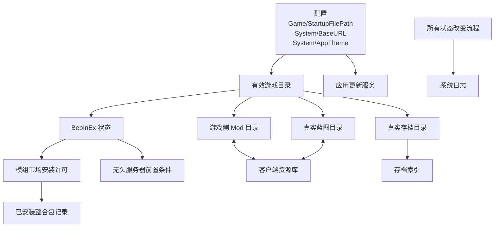
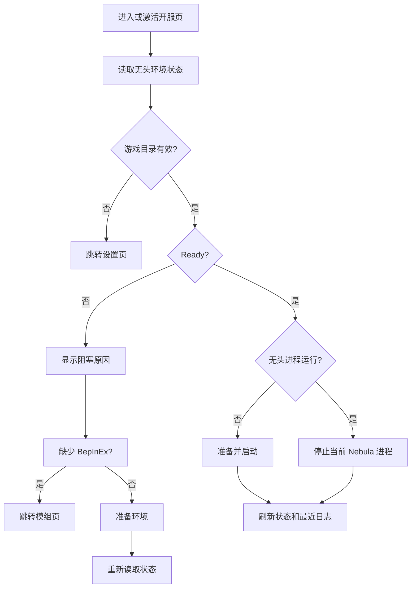
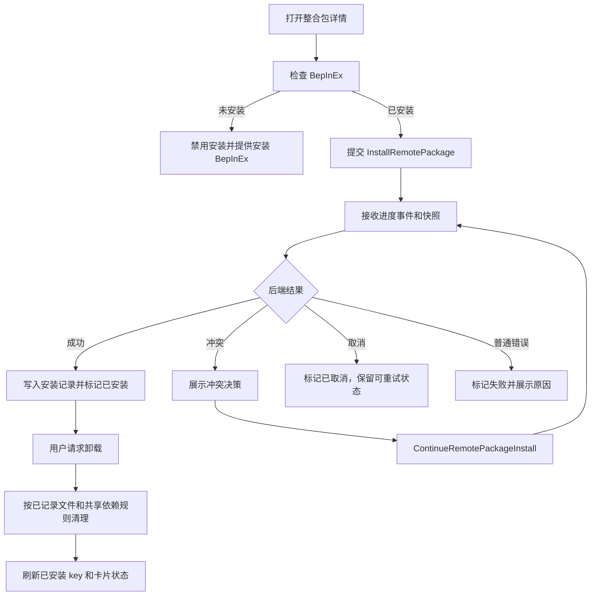
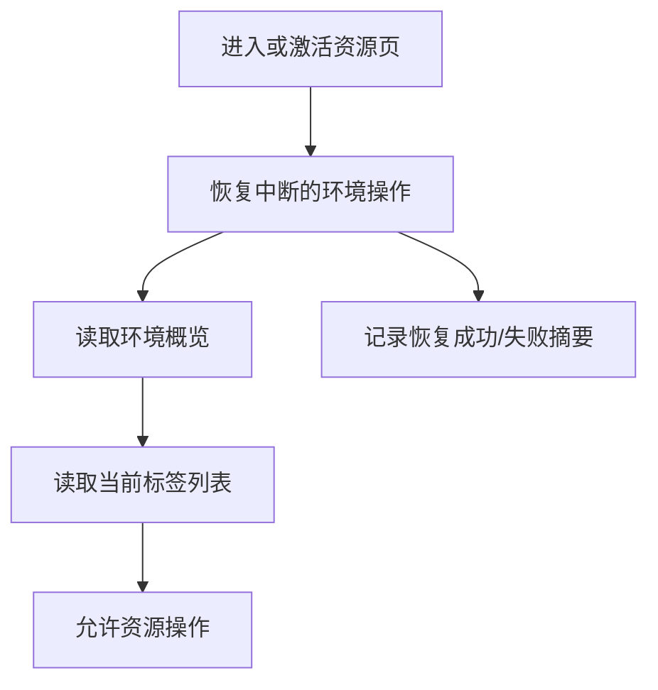
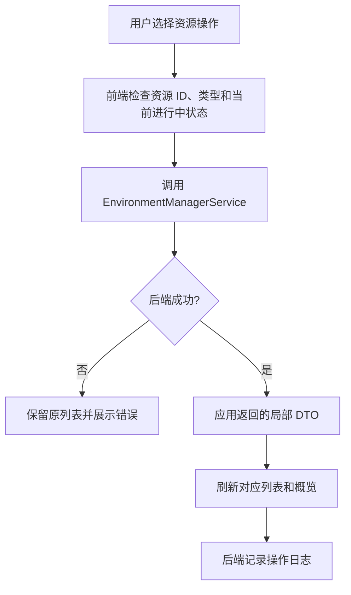
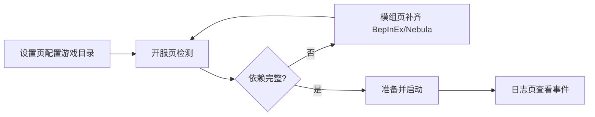
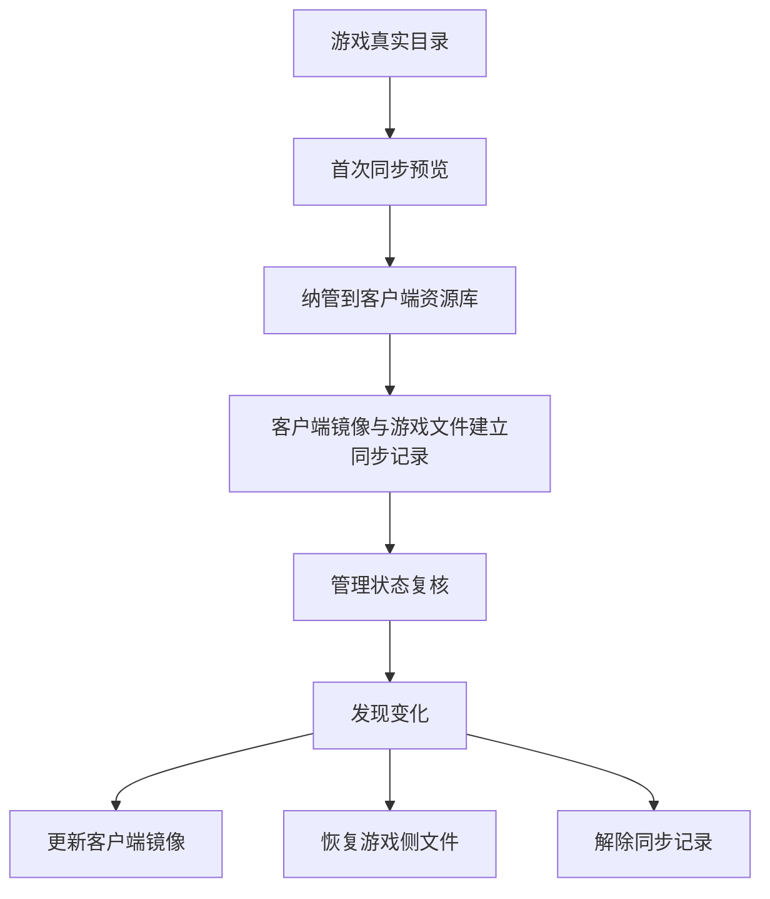

# DysonSphereBox UI 开发功能与逻辑说明

## 文档目的

本文档面向负责页面实现的前端或 UI 开发 agent。内容只描述当前项目已经存在的功能、数据、状态、页面关系和业务逻辑流，作为页面设计与实现的功能输入。

本文档不规定视觉风格、颜色、排版、组件外观、动效、间距或响应式方案。页面实现应以当前 Wails 服务契约和本文档中的状态边界为准，不应通过界面推断不存在的业务能力。

## 产品功能范围

DysonSphereBox 是《戴森球计划》的桌面辅助工具，当前功能分为以下领域：

| 领域 | 作用 | 主要页面 |
| --- | --- | --- |
| 应用壳层 | 页面导航、窗口控制、主题配置、首次使用引导 | 所有页面 |
| 游戏环境配置 | 设置游戏目录、连接地址和 BepInEx 状态 | 设置、模组、开服 |
| 模组市场与安装 | 浏览远程整合包，安装、取消、冲突处理、卸载模组 | 模组 |
| 无头服务器 | 检测 Nebula 开服条件，保存端口和存档，启动/停止服务 | 开服 |
| 本地资源管理 | 管理 Mod、蓝图和存档，导入、启用、同步、移动、导出和删除 | 资源 |
| 蓝图工具 | 预加载并嵌入外部蓝图生成器 | 蓝图 |
| 系统审计 | 查询、筛选、复制和导出操作日志 | 日志 |
| 应用维护 | 检查版本、执行自更新、查看项目信息 | 设置、关于 |

## 全局应用关系

### 页面入口

主导航当前包含以下路由：

| 页面 | 路由 | 主要职责 | 页面是否保持缓存 |
| --- | --- | --- | --- |
| 首页 | `/` | 预留的首页入口，当前只有占位内容 | 否 |
| 开服 | `/headless` | 无头服务器环境检测与进程控制 | 是 |
| 模组 | `/mod` | 远程整合包浏览与安装 | 是 |
| 蓝图 | `/blueprint-generator` | 外部蓝图生成器内嵌工具 | 是 |
| 资源 | `/environment` | 本地 Mod、蓝图、存档资源库 | 是 |
| 日志 | `/log` | 系统操作日志 | 否 |
| 设置 | `/settings` | 游戏目录、API 地址、BepInEx、应用更新 | 否 |
| 关于我们 | `/about` | 版本、项目链接、联系方式和致谢 | 否 |

`/dashboard` 是缓存测试页面，不在主导航中，不属于用户主流程。它只验证页面离开后内部计数是否保留。

### 应用壳层逻辑

1. Wails 启动后加载 Vue 应用和自动生成的路由。
2. 主布局根据当前路由的 `meta.title` 显示页面标题；没有标题时回退到应用名称。
3. 页面是否缓存由路由的 `meta.keepAlive` 决定。缓存页面切换回来时，页面可能继续保留原有本地状态，但开服、模组、资源页面仍会在激活时刷新后端状态。
4. 主布局提供返回首页、页面导航、应用版本读取、教程入口、主题切换和无边框窗口的最小化/最大化/关闭操作。
5. 主题值持久化到 `System/AppTheme`。切换主题是一个异步保存操作，保存期间不应重复提交。
6. 全局教程和页面教程由教程注册表定义。首次进入页面时读取“页面 key + 教程版本”的进度；已完成或已跳过的版本不会自动再次打开。用户可以通过教程入口手动重看。
7. 关键业务操作由后端记录系统日志；日志页面只是查询这些记录，不负责替代业务流程。

### 核心数据关系

### 路径和配置约束

- `Game/StartupFilePath` 实际保存的是经过归一化的游戏目录。目录必须能找到 `DSPGAME.exe`；只有通过校验后才允许保存。
- 模组页和开服页都依赖设置页保存的游戏目录。没有有效游戏目录时，模组市场安装和开服动作不能继续。
- `System/BaseURL` 为空时不主动请求远端服务；非空值必须是包含主机名的 HTTP 或 HTTPS 地址。保存成功后会替换全局 HTTP 客户端。
- 蓝图真实目录和存档真实目录可以在资源页单独选择并保存。选择器取消时不修改配置。
- 资源库是客户端管理目录，游戏侧 Mod、蓝图和存档目录是实际运行目录；两者不能在逻辑上混为一个目录。

## 页面功能说明

### 首页 `/`

当前页面只提供占位内容，没有后端数据、业务操作或跨页面动作。页面教程仍可以自动启动。

### 开服页 `/headless`

#### 功能目标

管理 Nebula 无头服务器的环境状态和进程。页面展示状态检测结果、依赖、网络采样、最近事件，并允许准备环境、启动、停止和保存开服设置。

#### 后端状态来源

`HeadlessService.GetEnvironmentStatus` 返回以下状态关系：

- 当前游戏目录是否已配置。
- BepInEx 是否安装及版本。
- Nebula 相关依赖是否安装。
- `steam_appid.txt` 等基础无头环境文件是否准备。
- Nebula 配置中的端口和启动存档。
- 当前无头服务器进程是否运行。
- 端口监听和上传/下载速率采样。
- 是否满足 `Ready` 条件以及不能启动时的原因。

#### 状态和动作关系

| 状态 | 页面应允许的主要动作 | 业务结果 |
| --- | --- | --- |
| 未配置游戏目录 | 跳转设置页 | 不能检测或启动 |
| 游戏目录已配置但缺少 BepInEx | 跳转模组页或执行准备 | 准备流程会尝试安装 BepInEx |
| BepInEx 已有但 Nebula 依赖缺失 | 跳转模组页安装依赖 | 不能强行启动 |
| 依赖完整但基础文件未准备 | 准备环境/启动 | 写入基础文件后重新检测 |
| 环境就绪且进程未运行 | 启动 | 启动 `DSPGAME.exe` 的 Nebula 无头进程 |
| 进程运行中 | 停止 | 只停止当前游戏目录下、带 Nebula 参数的进程 |
| 检测异常 | 重新检测 | 保留错误信息，重新请求状态 |

#### 逻辑流

#### 开服设置

- `hostPort`：保存到 Nebula 配置文件中的监听端口。
- `serverArchive`：下一次启动使用的存档名或路径文本；服务不会验证存档实际存在。
- 保存设置后返回最新状态，并刷新最近系统日志。
- 页面定时刷新状态，用于更新进程、端口和网络指标；离开或停用页面时应停止定时器。

#### 最近事件

开服页读取 `LogService.ListLogs`，过滤 `namespace=server` 和开服相关模块，按时间显示最近事件。日志读取失败不应阻断环境状态展示。

### 模组页 `/mod`

#### 功能目标

浏览远程整合包并管理安装状态。当前统一包 key 是来源感知的字符串，不能用不同来源的数字 ID 互相替代。

#### 前置条件

1. 页面进入时读取 `Game/StartupFilePath`。
2. 使用 `CheckDysonSphereExe` 判断目录是否包含 `DSPGAME.exe`。
3. 路径有效后调用 `SearchAndLoadBepInEx` 读取 BepInEx 状态。
4. 只有路径有效时才加载市场数据；没有有效路径时页面进入阻塞状态，并提供设置页跳转。
5. BepInEx 未安装时仍可以浏览市场，但整合包安装动作必须被阻止；页面可以直接调用 `BepInExService.Install`。

#### 市场浏览

- 当前来源由来源选择器控制，前端支持 `official`、`thunderstore`、`manual` 等来源值。
- 搜索关键词改变时，当前来源从第一页重新查询。
- 官方和 Thunderstore 来源支持分页和滚动到底部加载下一页。
- 手动来源当前只保留入口状态，不支持普通远端分页。
- 刷新动作重新请求当前来源；请求失败时保留已经加载的列表，并允许重试。
- 整合包详情弹窗展示名称、描述、作者、来源、封面、依赖数量和依赖明细。

#### 安装状态

每个整合包至少可能处于以下页面状态：

| 状态 | 触发 | 后续动作 |
| --- | --- | --- |
| 未安装 | 本地没有对应 package key | 可安装（前提是 BepInEx 已安装） |
| 安装中 | 已提交安装 | 显示阶段、进度、速度；允许取消 |
| 已安装 | 安装成功且本地记录存在 | 可卸载 |
| 失败 | 安装返回普通错误 | 显示错误信息，允许重试 |
| 冲突 | 文件复制发现冲突 | 显示冲突处理入口，选择覆盖、跳过或终止 |
| 取消中/已取消 | 用户请求取消 | 等待后端返回，不当作成功或普通失败 |

安装进度通过 `modDependence:installProgress` 事件推送。页面挂载或重新激活时读取进度快照和已安装 key；读取快照只恢复展示状态，不会自动重新启动安装。

#### 安装和卸载逻辑流

### 蓝图页 `/blueprint-generator`

#### 功能目标

加载并嵌入外部蓝图生成器页面。该页面不负责本地蓝图库的导入、移动或启用，那些操作属于资源页。

#### 加载逻辑

1. 请求外部蓝图生成器首页 HTML。
2. 从 HTML 中提取脚本、样式、字体和其他资源地址。
3. 预加载资源并统计总数、完成数、待处理数和失败数。
4. 预加载完成后创建或刷新 iframe。
5. 外部页面加载失败时显示错误和重新加载入口。
6. 页面卸载时中止未完成的预加载请求，避免组件销毁后继续更新状态。

### 资源页 `/environment`

#### 功能目标

管理三类本地资源：Mod、蓝图、存档。页面同时处理客户端资源库和游戏真实目录之间的同步关系。

#### 页面级状态

- 活动标签：`mods`、`blueprints`、`saves`。
- 各标签独立的搜索词和加载状态。
- 当前蓝图父文件夹 ID和面包屑目录。
- 资源级进行中 ID 集合；同一资源正在操作时不允许重复提交。
- 首次纳管预览、首次同步状态、管理状态复核结果和中断操作恢复结果。
- Mod、蓝图详情分别通过详情弹窗/抽屉读取；详情读取失败不清空列表。

#### 三类资源关系

| 资源 | 客户端资源库 | 游戏真实目录 | 主要状态 |
| --- | --- | --- | --- |
| Mod | 由客户端扫描和导入的 Mod 资源 | BepInEx/plugins 目录 | enabled、disabled、missing、unsupported、conflict |
| 蓝图 | 客户端蓝图库及文件夹树 | 真实蓝图根目录 | enabled、disabled、missing、conflict；文件夹无启用状态 |
| 存档 | 不复制进客户端资源库，只建立索引 | 真实存档目录 | 主要用于扫描、重命名、导入、导出、删除 |

#### 进入页面和恢复流程

恢复只清理系统已知的临时操作痕迹，并返回恢复摘要；不能据此推断用户文件已经全部修复。若管理状态存在冲突，需要让用户继续选择处理方式。

#### Mod 资源功能

- 搜索客户端 Mod 资源库。
- 从多个文件路径、zip 文件或目录导入 Mod。
- 支持桌面文件拖放导入 zip。
- 启用或禁用 Mod；每次操作成功后刷新 Mod 列表和概览。
- 删除 Mod 前需要确认；删除成功后刷新列表和概览。
- 查看 Mod manifest 详情，包括名称、版本、作者、网站、路径、说明、依赖和原始 manifest。
- 打开客户端 Mod 资源库目录或游戏真实 Mod 目录。
- 对存在同步记录的 Mod，支持“更新客户端镜像”“恢复游戏侧文件”“解除同步记录”。

#### 蓝图资源功能

- 搜索当前目录下的蓝图和文件夹。
- 通过文件夹 ID 进入子目录，支持返回根目录和面包屑切换。
- 创建文件夹。
- 导入 `.txt`、`.bp`、`.json` 等蓝图文件。
- 快速导入：输入蓝图名称和蓝图编码，由后端生成真实蓝图文件。
- 拖拽蓝图或文件夹移动到另一个文件夹。
- 重命名蓝图或文件夹。
- 启用或禁用蓝图。
- 查看蓝图详情和编码对应的模型预览；详情是只读能力。
- 导出蓝图到用户选择的目录。
- 删除蓝图或文件夹前需要确认。
- 蓝图移动或重命名可能影响已启用蓝图。后端会先返回迁移预览；若 `requiresConfirmation=true`，必须展示受影响条目并由用户确认后调用确认接口。
- 打开客户端蓝图库目录或真实蓝图目录；真实目录未确定时只能先选择并保存目录。

#### 存档资源功能

- 搜索真实存档目录中的存档文件。
- 导入一个或多个存档文件到真实存档目录。
- 重命名存档。
- 导出存档到用户选择的目录。
- 删除存档前需要确认。
- 打开客户端存档库目录或真实存档目录。
- 存档根目录未配置时，允许选择目录并保存；保存后重新扫描。

#### 首次同步与状态复核

首次进入资源页时，概览返回真实目录中可纳管的 Mod、蓝图和存档数量，作为预览。用户可以按 `all`、`mod`、`blueprint`、`save` 范围执行首次同步。

- Mod：把真实目录中的目录型 Mod 纳入客户端管理。
- 蓝图：把真实蓝图文件纳入客户端蓝图库。
- 存档：只建立索引，不复制到客户端资源库。
- 同步结果返回成功数量、失败明细和新的概览。
- 同步后可执行管理状态复核，返回检查数量、变化数量和冲突数量。
- 状态复核发现变化时，页面应保留冲突信息，让用户决定更新客户端镜像、恢复游戏侧文件或解除同步记录。

#### 资源操作通用逻辑

删除、恢复、解除同步等高风险操作必须先确认；提交期间不应允许重复提交或关闭确认流程。选择器取消不算错误，也不应改变当前列表。

### 日志页 `/log`

#### 功能目标

查询系统操作日志并提供筛选、分页、复制和文本导出能力。

#### 日志字段

每条日志包含以下通用维度：

- `dateTime`：发生时间。
- `level`：日志等级。
- `type`：日志类型。
- `namespace`：命名空间，例如 `system`、`modDependence`、`server`。
- `module`：业务模块，例如 `configuration`、`environment`、`installer`、`update`、`process`、`port`。
- `event`：事件名。
- `content`：用户可读内容。
- `error`：错误详情，可为空。
- `metadata`：通用结构化键值，可为空。

#### 查询逻辑

- 支持按命名空间、模块、事件名、日志等级和日志类型筛选。
- 任意筛选条件改变后回到第一页并重新请求。
- 分页支持切换页码和每页数量。
- 刷新只重新请求当前筛选条件。
- 无结果时显示空结果状态，读取失败时保留错误和重试入口。

#### 复制和导出

- 复制单条日志时，将内容、时间、等级、类型、命名空间、模块、事件、错误和 metadata 组合为纯文本。
- 导出按当前筛选条件批量读取所有分页，生成 `.txt` 文件。
- 没有可导出日志时不创建文件。

### 设置页 `/settings`

#### 游戏路径

1. 用户可以输入路径、选择目录或点击自动获取。
2. 输入变化时调用 `CheckDysonSphereExe` 异步校验；并发校验只接受最后一次请求结果。
3. 选择目录后如果没有 `DSPGAME.exe`，不保存并提示重新选择。
4. 自动获取优先读取已保存目录，否则从 Steam 查找；找不到时不写入无效路径。
5. 手动输入只有在路径变化且校验通过后才显示确认保存动作。
6. 保存成功后同步更新模组、开服和资源页使用的游戏目录。

#### 连接地址

- 读取并保存 `System/BaseURL`。
- 非空值必须是完整 HTTP/HTTPS 地址；空值表示不主动请求远程服务。
- 保存成功后后端验证并替换全局 HTTP 客户端；验证失败时保留原配置。

#### BepInEx

- 读取当前游戏目录下的 BepInEx 安装状态和版本。
- 点击检查只读取状态，不安装。
- 点击卸载必须二次确认。
- 卸载会移除 BepInEx、Doorstop 注入文件和已安装依赖模组，并清空本地模组安装记录；不会删除游戏本体。
- 卸载完成后模组页和开服页的前置状态都应视为未安装。

#### 应用更新

- 进入设置页时可自动检查一次；同一程序周期内重复进入页面不重复请求，用户手动检查会强制刷新。
- 检查结果包含当前版本、最新版本、是否有更新、运行平台、更新包名称和发布说明。
- 只有检测到可用更新时才允许打开更新确认。
- 确认后下载并校验更新包，成功替换当前程序；完成后需要用户重启应用。
- 更新失败时保留当前程序并展示错误。

### 关于页 `/about`

提供以下只读信息：

- 当前应用版本。
- 开发者名称。
- 项目主页和问题反馈链接。
- 微信号和 QQ 群号复制入口。
- 第三方项目和模组鸣谢。
- 使用模组的免责声明。

外链在外部窗口打开；联系方式点击后复制文本，剪贴板 API 不可用时使用备用复制方式。

## 跨页面关系与导航流

### 首次配置到模组安装

### 首次配置到开服

### 资源同步关系

### 日志关系

以下流程都会由后端记录操作日志，然后由日志页统一查询：

- 游戏路径和 BaseURL 配置。
- BepInEx 安装、检查、卸载。
- 模组下载、安装、冲突、取消、卸载。
- 开服环境准备、设置保存、启动、停止、端口和进程状态。
- 资源导入、启用/禁用、同步、恢复、导出、重命名、删除。
- 应用更新检查和自更新。

## 统一状态处理要求

### 加载状态

- 页面首次读取和局部刷新应可区分，局部刷新不能无理由清空已有数据。
- 长任务需要显示进行中状态，并阻止同一资源或同一流程重复提交。
- 页面缓存重新激活后，应重新读取可能在其他页面发生变化的后端状态。

### 错误状态

- 后端错误应转成用户可读文本。
- 错误不应伪造成功状态；操作失败时保留最后一次可信数据。
- 可重试的读取失败应提供重新请求入口。
- 选择器取消、用户关闭详情或没有搜索结果不属于错误。

### 确认状态

以下动作需要用户明确确认：

- 卸载 BepInEx。
- 卸载或删除 Mod。
- 删除蓝图、蓝图文件夹或存档。
- 蓝图移动/重命名导致已启用内容迁移时的确认。
- 应用自更新。
- 恢复游戏侧文件或解除同步记录等可能改变真实目录的操作。

提交确认后，在后端返回前禁止重复提交；后端失败时关闭或保留弹窗的行为应与当前页面已有流程一致，但不能把失败当作完成。

### 刷新和缓存

- 模组页激活时恢复安装进度快照、已安装 key、游戏路径和 BepInEx 状态。
- 开服页激活时重新读取环境状态并重新加载最近日志，定时刷新只在页面处于活动状态时运行。
- 资源页激活时恢复中断操作并刷新概览；标签页切换按需加载对应列表。
- 日志页激活时可以重新启动当前条件下的查询，但不应改变筛选条件。

## 当前后端服务能力索引

| 服务 | 主要方法 | 被哪些功能使用 |
| --- | --- | --- |
| `system.EnvironmentService` | `LoadOrInitDysonSphereExe`、`CheckDysonSphereExe` | 设置、模组前置检查 |
| `system.ConfigurationService` | `GetConfig`、`SetConfig` | 游戏目录、BaseURL、主题及其他配置 |
| `modDependence.BepInExService` | `Install`、`Uninstall`、`GetStatus`、`SearchAndLoadBepInEx` | 设置、模组、开服准备 |
| `modDependence.MarketplaceService` | `GetRemotePackageList`、`RefreshRemotePackageList` | 模组市场 |
| `modDependence.InstallerService` | `InstallRemotePackage`、`ContinueRemotePackageInstall`、`CancelRemotePackageInstall`、`UninstallRemotePackage`、进度/已安装查询 | 模组安装状态 |
| `modDependence.HeadlessService` | `GetEnvironmentStatus`、`SaveSettings`、`PrepareEnvironment`、`StartEnvironment`、`StopEnvironment` | 开服页 |
| `environment.EnvironmentManagerService` | 概览、列表、导入、启用/禁用、同步、移动、重命名、导出、删除、目录选择和操作查询 | 资源页 |
| `system.LogService` | `ListLogs`、`CreateLog` | 日志页和开服页最近事件 |
| `system.UpdateService` | `GetAppVersion`、`CheckAppUpdate`、`UpdateAppSelf` | 设置、关于、主布局版本显示 |
| `system.TutorialService` | `GetTutorialProgress`、`MarkTutorialCompleted`、`SkipTutorial`、`ResetTutorialProgress` | 全局和页面教程 |

## 实现边界

- 页面只编排展示状态和用户动作；文件复制、压缩包处理、数据库事务、进程控制和审计日志由后端服务/帮助层负责。
- 不应把 GORM 模型直接当作前端业务 DTO；前端应依赖生成的 Wails DTO 类型。
- 不应通过删除卡片或清空列表来表示后端操作成功；必须使用后端返回结果或重新查询确认。
- 不应将“猜测出的路径”当作已经授权的真实目录；真实目录需要存在性、来源和确认状态分开处理。
- 模组安装的来源 key、安装进度、冲突和取消是独立概念，不能把冲突或取消统一显示为普通失败。
- 存档属于真实目录索引资源，不应按 Mod/蓝图的客户端镜像规则推断其存储关系。
