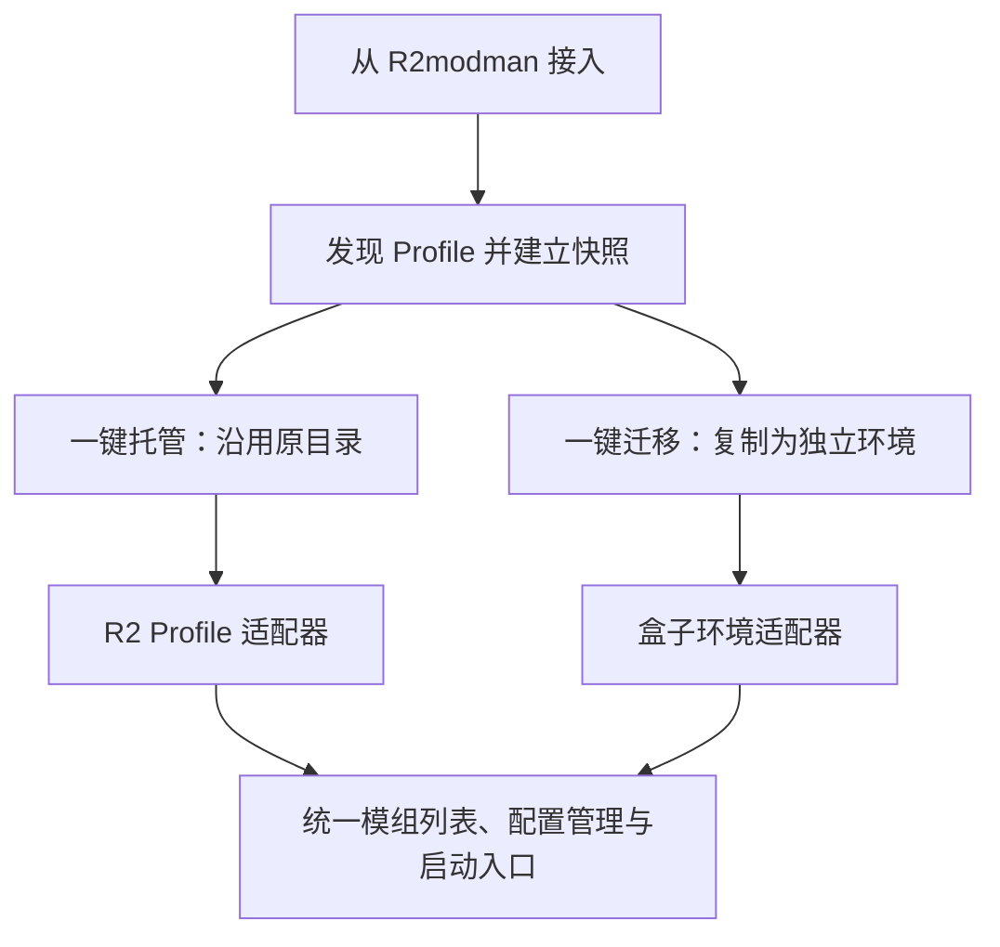

# r2modman 一键托管与一键迁移方案

状态：设计草案，尚未实现。调研日期：2026-11-13。

本文中的 R2 均指 r2modman 模组管理器。目标用户已经在 R2 中安装和配置了戴森球计划模组，希望直接转到盒子使用，不必重新下载、逐项安装或重新配置。

## 1. 产品目标与两个入口

提供一个“从 R2modman 接入”入口，自动发现现有 Profile，展示摘要后提供两个操作：

| 操作 | 文件位置 | 接入后的管理方式 | 原 R2 数据 |
| --- | --- | --- | --- |
| 一键托管 | 沿用原 Profile | 盒子通过 R2 适配器管理现有环境 | 保留，后续改动直接作用于原 Profile |
| 一键迁移 | 复制到盒子的独立环境 | 盒子维护副本的安装记录和运行环境 | 保留，迁移完成后两边独立 |

两种方式接入后，都应能查看真实模组列表、管理配置、启用和禁用模组、启动对应环境，并在兼容范围内安装、升级和卸载。仅能看见列表或打开目录，不算完整托管。

默认推荐“一键迁移”：用户确认的 Profile 被复制到盒子可管理的独立位置，原有 R2 环境可以继续使用。希望继续沿用原路径、避免复制的用户选择“一键托管”。

“一键”指选择接入方式后一次执行完整流程。常规情况自动处理；多个 Profile 时提供选择和批量接入。只有源目录变化、文件缺失等需要用户决定的问题才中断，不逐个模组弹确认。

## 2. 当前不能直接托管的原因

以下结论来自当前源码，不能把“安装布局与 R2 一致”等同于“能管理现有 R2 环境”。

| 当前实现 | 对接 R2 时的缺口 | 源码依据 |
| --- | --- | --- |
| 已安装列表聚合盒子数据库中的包、组件和文件记录 | 不会从 R2 Profile 自动识别已安装内容 | [installed.go](../helper/modDependence/installer/v2/query/installed.go) |
| 包 key、组件 key 使用全局唯一索引 | 同一模组在不同 Profile 中的安装状态无法独立保存 | [package.go](../model/modDependence/installed/package.go)、[component.go](../model/modDependence/installed/component.go) |
| 安装准备从游戏目录中的 BepInEx 状态取得目标根 | 不能仅替换一个路径就安全地安装到 R2 Profile | [install_prepare.go](../helper/modDependence/installer/v2/install_prepare.go) |
| 配置目录采用 untracked 规则，不进入安装文件归属清单 | 配置需要独立管理，不能通过安装记录完整反推 | [resolve.go](../helper/modDependence/installer/artifactlayout/resolve.go) |
| 前端安装、失败和进度状态主要按包 key 保存 | 切换 Profile 后可能混用状态或接收错误环境的事件 | [useModPageState.ts](../frontend/src/composables/dysonSphere/useModPageState.ts) |
| 环境资源库主要围绕游戏 plugins 目录同步 | 普通目录导入不能代替 Profile 迁移 | [path.go](../helper/environment/path.go) |

R2 是本地环境的管理方式，模组市场来源仍然是 Thunderstore 或 manual。无需为此增加一个与 Thunderstore 并列的远端市场来源 `r2`。

## 3. 接入单位是整个 Profile

Profile 的逻辑位置为 `<R2 数据根>/DysonSphereProgram/profiles/<Profile 名>`。数据根允许被修改，因此默认路径只是发现候选，必须支持用户选择自定义数据根或具体 Profile。[R2 路径实现](https://github.com/ebkr/r2modmanPlus/blob/master/src/model/Profile.ts)、[DSP 游戏定义](https://github.com/ebkr/r2modmanPlus/blob/master/src/assets/data/ecosystem.json)。

接入范围包括：

- 模组身份、实际版本、依赖声明和启用状态。
- BepInEx 加载器，以及 plugins、patchers、monomod 等实际文件。
- `BepInEx/config` 中的用户配置及必要的自定义配置文件。
- 手工放入的本地模组、资源文件，以及无法匹配远端的内容。
- 启动所需的游戏路径、加载器版本、Profile 路径和参数。

R2 的 `mods.yml` 提供模组清单；`versionNumber`、`enabled` 等信息由其 Manifest 表达。盒子应将清单与磁盘核对，分别记录“声明的安装状态”和“实际文件状态”。[清单读取实现](https://github.com/ebkr/r2modmanPlus/blob/master/src/r2mm/mods/ProfileModList.ts)、[Manifest 实现](https://github.com/ebkr/r2modmanPlus/blob/master/src/model/ManifestV2.ts)。

例如：清单存在但文件缺失，应显示“文件缺失”；磁盘有本地模组但清单未登记，应显示“本地模组”。不能把前者当成可用，也不能在迁移时忽略后者。

## 4. 用户实际操作流程

### 4.1 自动发现与接入预览

1. 盒子发现 R2 数据目录，或由用户选择目录。
2. 列出全部 DSP Profile，显示名称、模组数量、启用/禁用数量、配置数量、占用空间和异常项。
3. 只有一个有效 Profile 时默认选中；多个时允许单选、多选或全选。不擅自覆盖盒子当前环境。
4. 用户点击“一键托管”或“一键迁移”，后台完成扫描、登记或复制、校验和提交。
5. 完成后进入已接入环境；多个环境时保留环境选择器。

无法发现 R2 时提供“选择 R2 数据目录 / Profile 目录”。不要求用户先从 R2 导出分享码。

### 4.2 一键托管

执行流程：校验 Profile → 建立一致性快照 → 识别模组与配置 → 建立文件归属证据 → 注册运行环境 → 切换到该环境。

- 接入过程不重新下载模组，也不为了生成安装记录而重装现有文件。
- 初始接入主要写盒子的登记、快照和操作记录；保留 R2 原始元数据。
- 后续启停、安装、更新和卸载通过 R2 适配器执行，维护 R2 清单与对应的文件变化。
- 取消托管只解除盒子的管理登记，保留 Profile 当前文件和配置；不自动撤销用户托管期间的全部操作。
- 支持范围内，解除托管后应能重新由 R2 识别和管理。

完整托管须通过对应 R2 格式的兼容验证。未知格式可以识别和预览；不能把缺少写入兼容能力的环境标记为“完整托管”。

### 4.3 一键迁移

执行流程：校验源 Profile → 生成文件与元数据快照 → 复制到盒子暂存目录 → 校验文件 → 转换安装记录 → 提交独立环境 → 切换环境。

建议目标位于 exe 同级 `appData` 下独立的运行环境目录，与现有资源库目录分开。具体目录名由实现阶段统一确定，内部身份使用稳定 ID，不直接使用可能重名的 Profile 名。

- 以现有文件为迁移主体，保留精确版本，不把“迁移”变成“重新安装最新版”。
- 本地文件完整时，远端包已下架或网络不可用不应阻止迁移。
- 保留禁用状态、用户配置、本地模组、额外资源和已经修改过的文件。
- 复制产生独立文件，不用指向原 R2 目录的 junction、符号链接或硬链接充当迁移结果。
- 原始 `mods.yml` 和相关证据留作来源快照；迁移后的管理以盒子记录为准。
- 转换后的记录不得继续依赖 R2 缓存目录或 `_state` 中的源绝对路径。
- 默认不修改现有游戏目录的模组，不清空目标目录，不删除原 R2 数据。

“迁移到游戏目录”可以后续增加，但涉及与现有模组合并和覆盖，不作为默认一键路径。

## 5. 模组识别、版本和文件归属

### 5.1 扫描结果

每个条目分别记录身份、版本、启用状态、物理位置、文件证据和可用操作。不要用单个“已安装”布尔值代替这些状态。

| 情况 | 展示和迁移策略 |
| --- | --- |
| 清单与文件一致 | 保留原版本和启用状态，建立管理记录 |
| 模组被禁用 | 保留禁用文件布局及状态，不在迁移过程中启用 |
| 清单有记录，文件不完整 | 列出缺失项；可保存副本，但不能报告环境完全就绪 |
| 文件存在但不在清单 | 作为本地内容保留；归属不确定时限制自动删除 |
| 远端不存在，文件完整 | 正常接入和迁移；升级能力单独标记 |
| 文件被用户修改 | 原样保留，以当前内容建立基线，不用远端包覆盖 |
| 清单字段或版本未知 | 保留原始数据并报告格式问题，不能当成空清单继续 |

R2 当前 DSP 安装规则使用模组子目录跟踪插件等文件，配置目录使用 `none`；子目录禁用实现会将相关文件改成 `.old`。必须按支持版本的规则识别，不能只处理 DLL 或只改 `enabled`。[安装及启停实现](https://github.com/ebkr/r2modmanPlus/blob/master/src/installers/InstallRulePluginInstaller.ts)。

### 5.2 文件归属

优先结合清单、DSP 安装规则、实际目录和可用的 R2 跟踪证据建立归属。目录名相似不能直接授予递归删除权限；缺少归属证据的文件作为保留内容。

配置单独维护，卸载模组默认保留用户配置。手工模组保持稳定的本地身份，只有身份得到确认时才关联到 Thunderstore 包。

### 5.3 依赖与版本

初次接入不自动升级依赖。R2 清单中的依赖声明用于重建关系，但不能据此可靠还原“用户主动安装”还是“自动附带安装”。初始条目按用户保留项处理，不在第一次卸载其他模组时自动清除。

后续升级再生成明确的变更计划，说明所选模组和必要依赖的变化。旧版本不可下载与本地文件可继续运行是两个不同状态。

## 6. 运行环境与架构调整

新增运行环境概念，至少包含稳定 ID、显示名、环境类型、游戏目录、模组根目录、配置根目录、管理方式、适配器版本及源 Profile 信息。

必须区分 `gameDir` 和 `profileRoot`。`Game/StartupFilePath` 继续表示包含 `DSPGAME.exe` 的真实游戏目录，不能改成 R2 Profile 路径。

市场索引和不可变下载缓存可以共享；实际安装状态、文件归属、共享依赖引用、配置、操作和进度必须按环境隔离。

- 包身份继续使用现有 `thunderstore:namespace:name:version`，不把环境信息拼进来源身份。
- 包记录唯一性改为环境与包 key 的组合；组件及关联记录同步带环境作用域。
- 操作上下文固定环境 ID、目标根和快照版本；执行中切换页面或当前环境不能改变落盘目标。
- 卸载、版本替换、冲突恢复、取消和启动恢复都必须使用同一环境上下文。
- Wails 事件、进度快照、前端状态映射和异步返回结果带环境 ID，防止旧请求覆盖新环境。

现有数据库迁移属于独立数据迁移：不能只增加字段和 AutoMigrate。须调整旧唯一索引，并根据已有文件路径、相对路径和安装清单归属旧记录。若存在多个历史目标根，不能统一塞给当前游戏目录；无法可靠归属的记录保留并限制写操作，等待定位。不得通过修改模板 `app.db` 迁移运行中数据。

## 7. 配置与启动必须随环境工作

### 7.1 配置管理

接入后直接扫描该环境的 `BepInEx/config`。BepInEx 配置通常以插件 GUID 命名，不等于 Thunderstore 包名；需要保留独立配置列表，并允许一个模组关联多个配置或暂时无法关联。[BepInEx 配置文档](https://docs.bepinex.dev/articles/user_guide/configuration.html)。

- 首期提供文件列表、原文编辑、备份恢复和搜索；结构化配置表单可以后续补充。
- 保存前检查读取时的内容指纹，发现游戏、R2 或其他编辑器修改时重新加载或展示差异。
- 不重排或丢弃未知字段、注释、编码和换行；结构化编辑必须能保留未识别文本。
- 不因首次运行尚未生成配置就标记迁移失败，也不伪造空配置。
- 操作日志记录环境、路径、结果和备份信息，不保存完整配置内容。

### 7.2 对应环境启动

只显示 R2 模组而继续用原启动流程，会造成“盒子显示已安装，但游戏没有加载”。启动适配必须纳入最小可用范围。

R2 的启动逻辑会按 Doorstop 版本生成不同参数，并解析 Profile 内的 Preloader 路径；还有必要文件的准备逻辑。[BepInEx 启动指令](https://github.com/ebkr/r2modmanPlus/blob/master/src/r2mm/launching/instructions/instructions/loader/BepInExGameInstructions.ts)、[路径解析](https://github.com/ebkr/r2modmanPlus/blob/master/src/r2mm/launching/instructions/GameInstructionParser.ts)、[文件准备](https://github.com/ebkr/r2modmanPlus/blob/master/src/r2mm/manager/ModLinker.ts)。

首期支持 Windows 下已验证的 DSP/BepInEx/Doorstop 组合，优先打通 Steam 版本。启动时检查 Profile、Preloader、必要注入文件与实际游戏路径；准备游戏根文件前建立备份及归属记录，发生冲突时不覆盖既有未知文件。

迁移后的启动参数指向盒子副本。应实机验证加载器日志、插件加载路径和配置写入位置；仅成功创建进程不能认定环境启动正确。

现有无头开服和 Nebula 设置不能因切换客户端环境而自动改写。后续接入服务端环境时，明确传入服务端环境 ID。

## 8. 一键操作的可靠性

### 8.1 统一任务流程

`扫描 → 预检 → 暂存/登记准备 → 校验 → 提交 → 完成`

持久化任务 ID、动作、源 Profile、目标环境、快照指纹、已完成步骤和备份位置。长任务不持有整个文件复制期间的数据库事务；文件系统阶段与短数据库事务通过任务日志协调。

- 托管初次提交先登记为不可写，验证清单及磁盘未变化后再激活管理能力。
- 迁移写入目标卷上的任务暂存目录，校验后发布最终目录，再提交数据库与激活状态。
- 目录发布后、数据库提交前崩溃，重启根据任务记录继续提交或清理盒子创建的未发布环境。
- 未完成环境不可作为可启动环境；重试同一任务不得重复复制或产生重复登记。
- 批量接入按 Profile 分别提交，明确成功、失败和未处理数量，不把部分完成报告为全部成功。
- 完成提示区分“已托管/已迁移”和“存在缺失文件、尚未就绪”，正常路径提供“使用此环境启动”。

### 8.2 外部变化与并发

盒子的锁只能约束盒子自身，不能假设 R2 遵守盒子的锁文件。

- 同一 Profile 的盒子写操作串行，元数据和文件变更前后检查快照。
- 完整托管的结构性写操作要求相关 R2 实例和游戏已退出；不能仅检查全局 R2 进程名就声称已取得排他锁。
- 一致迁移需要稳定源快照；复制期间发生源变化时停止提交并重新扫描，不能发布混合版本的副本。
- 重新进入页面、应用激活或执行操作前复核源状态；R2 改动后先刷新再继续。
- 多文件操作不存在天然原子性，必须保留每步恢复记录；恢复只触及本任务拥有的文件，不清理原 Profile 未知内容。
- 解析真实路径并处理 Windows 重解析点，所有目标写入都限定在已确认环境范围内。

### 8.3 R2 导出文件的定位

`.r2z` 和分享码可以作为后续补充入口。官方说明导出导入并不能恢复全部手工安装或本地导入模组，因此它们不能成为一键完整迁移的唯一来源。首期直接读取本地 Profile。[R2 Profile 文档](https://github.com/ebkr/r2modmanPlus/wiki/Profiles)。

## 9. 代码落点建议

目录随实际实现建立，不提前创建空目录。边界沿用现有项目约定。

| 层级 | 建议职责 |
| --- | --- |
| `service/modDependence/` | 接入预览、托管、迁移、取消托管及统一管理服务；负责校验、任务编排、事务和审计决策 |
| `helper/modDependence/r2profile/` | 发现、清单解析、磁盘核对、兼容写入和 R2 文件规则 |
| `helper/modDependence/runtimeenv/` | 环境解析、固定操作上下文与适配器选择 |
| `helper/modDependence/configuration/` | 配置扫描、原文编辑、指纹比较和备份读写 |
| 现有 `installer/v2` 子包 | 复用下载、解压、规划和恢复能力，改为显式环境上下文；不直接假装 R2 安装是盒子原生安装 |
| `model/modDependence/` | 环境、接入任务和环境作用域安装记录，在既有注册链注册 |
| `constant/modDependence/` | 接入动作、任务阶段、环境类型、能力与事件名 |
| 前端 services / composables | 生成绑定的调用、接入任务状态、环境切换及事件过滤 |

R2 本地 YAML 不是远端 API，无需给它编造 HTTP 接口。只有真正的外部接口契约和路径进入 `apiDefinition/`。安装审计沿用已有通用日志维度，环境和任务信息放 metadata。

## 10. 实施顺序与交付口径

### 阶段一：共同基础

完成 Profile 发现、清单与磁盘核对、环境上下文、数据迁移设计和接入预览。可以内部验证，但对用户不能宣传“已支持一键托管”。

### 阶段二：一键迁移闭环，优先交付

完成独立环境、精确文件复制、禁用状态与配置保留、安装记录转换、对应环境启动、任务恢复，以及迁入模组后续启停/升级/卸载。

优先迁移是因为副本可以完全由盒子管理，减少首版对 R2 写入格式的耦合；原位托管仍然是明确交付目标。

### 阶段三：一键原位托管

补齐经过验证的 R2 清单和文件状态写入、安装升级卸载兼容、外部变化复核与解除托管。验收包含“盒子修改后，R2 重新打开能识别结果”。

### 阶段四：体验扩展

补充配置结构化编辑、`.r2z`/分享码导入、环境复制与批量操作。是否扩展其他管理器另行决定。

## 11. 关键验收场景

1. 包含启用模组、禁用模组、配置和手工 DLL 的真实 R2 Profile，完成接入后数量、版本和文件内容一致。
2. 完整本地 Profile 在断网或远端版本下架时仍可迁移；迁移不请求最新版替换旧版。
3. 同一模组不同版本存在于两个 Profile，切换、升级和卸载互不影响。
4. 迁移后对副本的配置编辑、启停和卸载不改变原 R2 文件；副本不依赖原目录存在。
5. 原位托管后执行启停、升级与卸载，解除托管再由 R2 打开，清单和实际文件一致。
6. 复制中取消、空间不足、权限失败、源文件改变或进程崩溃，不产生显示成功但不可用的环境。
7. 用户自改文件、无法归属的文件、未知配置和本地模组不会被覆盖或遗漏。
8. 实际启动加载所选环境的插件，并把运行时配置写入同一环境。
9. 源路径含中文、空格、自定义数据根和重名 Profile 时仍可正确接入。

实现时为清单解析、文件归属、环境隔离和中断恢复建立有实际价值的自动化验证；再执行前端构建、Go 编译和绑定检查，并通过 Wails 实机完成启动与回到 R2 的验证。构建通过不等同于以上行为验收通过。

## 12. 仍需实机确认的兼容边界

- 首批支持的 R2 版本与实际 Profile 样本，记录所采用上游规则的固定版本，不能长期跟随浮动 master 自动推断写入格式。
- 自定义数据根、旧清单、用户修改过的禁用文件和额外根文件的真实分布。
- Windows DSP 的加载器、Doorstop 与游戏目录原有注入文件共存情况。
- Steam 以外发行渠道的启动方式；未验证渠道应明确能力范围。

上述项目影响兼容覆盖与验收，不改变已经确定的产品方向：原 R2 用户能够选择原地托管或复制迁移，并在盒子内继续管理和使用现有模组环境。
