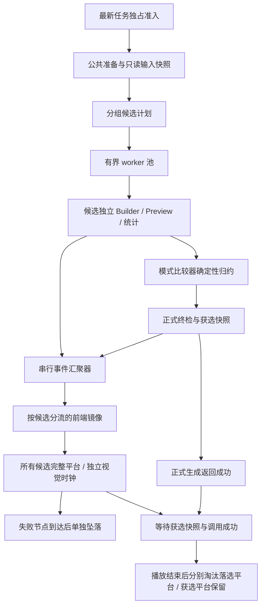

# 候选并发计算与多平台算法可视化方案

日期：2026-11-07。状态：核心代码已落地，验证进行中。实施差异与已完成检查见[验证记录](候选并发与可视化验证记录.md)；本文标注的建议性能目标仍需单独验收，不代表已测得。

## 1. 目标与范围

一次蓝图生成内部以有界 Go worker 池并发计算独立候选。算法可视化将所有实际候选完整铺开，每个平台按独立视觉时钟展示真实的机器放置、传送带连接、调整与回退。失败候选在自己的播放时间线到达失败节点时立即单独坠落，不等待其他候选。搜索结束后，其余确认落选的平台分别退场，最终只留下唯一获选平台。

2026-11-07 用户确认：取消完整平台数量上限和列表替代；失败即独立退场；视觉速度独立于计算速度，允许算法已经算完、前端仍在演示。这里的“立即”指视觉时间线到达失败节点后立即执行，不能收到失败消息就越过尚未播放的生成过程。

保留既有视觉要求：戴森球计划太空科幻配色、模型原生材质、2.5D 正交视角；平台只有建筑下方的薄层，不增加底座和支柱；扩展范围时新地块从下方升起；传送带模型与流动方向一致。临时建筑可以使用现有全息状态，但不可重新按候选给实体模型染色，候选通过平台编号和边框区分。

本方案已进入实施阶段，改动覆盖后端调度、预览协议、前端适配器和渲染包。

## 2. 当前实现与根因

以下结论按当前工作区源码核对，历史聊天中的候选数量仅作背景，不作为固定预算。

| 位置 | 当前行为 | 改造影响 |
| --- | --- | --- |
| `helper/factory/generation_tasks.go` | 新请求取消旧请求，以容量 1 的槽串行准入 | 继续保持任务级独占，槽内运行候选 worker 池 |
| `helper/blueprint/build/algorithm/mode1.go` | `generateConnectedVariants` 串行比较；主候选都失败才进入兼容入口组 | 必须保留候选组屏障与回退条件 |
| `algorithm/standard_fly_field.go`、`dense_fly.go`、`dense_station.go` | 不同模式按自身比较器选优；部分候选读取当前最优指标进行剪枝 | 不可统一改成先完成者获胜 |
| `algorithm/primitives.go` | `newCandidateBuilder` 继承 `adapter` 和同一个 `preview` 指针 | 直接增加 goroutine 会共享可变预览状态 |
| `algorithm/generation_preview.go` | 单个 `generationPreview` 保存 `nextID`、`stage`、Notifier；回退同步空场景，最终切为 area 坐标 | 需要候选独立会话与最终候选身份 |
| `algorithm/progress.go` | 序号原子递增，之后同步调用观察者 | 原子取号不保证并发回调按序送达 |
| `helper/blueprint/build/preview/notifier.go` | Notifier 保存上一场景与差量状态 | 每个候选必须独占实例 |
| `frontend/src/composables/dysonSphere/useAlgorithmFeed.ts` | 一份镜像和一组任务对象身份 | 改成按候选维护镜像 |
| `frontend/src/packages/algorithm-viz/src/scene.ts` | 一个 IslandLayer、一套对象池和跟随队列 | 引入候选平台实例和全局资源预算 |

高频换形来自多个候选轮流覆盖同一个场景，以及最终提交切换坐标系。多平台必须使用明确的候选身份，不能根据大量删除猜测边界。仅给现有共享 Notifier 加锁仍会把不同候选当作同一场景，无法解决语义问题。

## 3. 总体结构

后端 worker 数限制计算并发，不限制展示平台数量。所有实际候选都拥有完整场景；前端帧预算只影响每帧处理工作量，不改变候选集合、建筑内容、比较指标或最终结果。

## 4. 后端并发设计

### 4.1 候选计划与调度

新增聚焦于候选调度的内部模块，建议位于 `helper/blueprint/build/algorithm/search/`。模块只处理任务描述、worker 生命周期与结果收集，不能反向导入父包造成循环依赖；具体装配通过父包注入的执行函数调用。

候选描述包含稳定的 `candidateId`、`ordinal`、`groupId`、策略参数和执行函数。ID 在派发前分配，由候选组与组内序号构成，不以 goroutine 启动或完成顺序生成。几何探测用临时 Builder 不计为展示候选；嵌套优化属于父候选内部阶段，避免嵌套 worker 池造成并发倍增。

建议初始并发上限为 `min(候选数, max(1, min(4, GOMAXPROCS-1)))`，支持内部配置覆盖为 1、2、4。该值需要通过 CPU、内存和耗时基线调优；不修改全局 GOMAXPROCS。并发提高吞吐的实际幅度取决于候选开销、剪枝和内存压力，不承诺线性加速。

候选按原顺序组成固定波次，每波最多 W 个；波次内并发，波次结束后串行归约。下一波读取上一波确定的最优指标快照。这会损失少量动态调度效率，但避免完成顺序改变剪枝条件。首期不允许运行中的候选读取不断变化的全局 best。

直连带先完成全部主候选组，仅全部无可行结果时才生成兼容入口组。其他模式必须逐项核对现有 fallback、黑盒候选和全场候选之间的依赖：只有证明相互独立的候选可进入同一波，保持原有应比较的候选集合。预算提前终止及剪枝必须有等价性依据，不能把当前可行解误当最终最优。

### 4.2 数据与状态隔离

每个候选独占 Builder、实体、占位/碰撞表、寻路缓存、区域记录、物流摘要、诊断集合、预览 ID 分配器、Notifier 和候选性能统计。`newCandidateBuilder` 不能继续无条件继承同一预览指针。

Dataset、规范 plan、FlowGraph、setting、adapter 中的切片、map 和闭包需逐项审计。确认整个调用链只读的内容可共享；会排序、补默认值、追加或写缓存的内容必须在公共准备阶段完成，或按候选复制。结构体浅拷贝不保证内部 map/切片隔离。共享配置在任务开始时冻结，worker 不读取随 UI 变化的配置。

性能计数按候选局部记录，汇聚器归并；现有性能 context 即使已加锁，也需检查阶段开始/结束语义是否会被并发覆盖。日志及观察者只能由汇聚器统一发布。

### 4.3 选优与结果生命周期

维持每个模式原有的多级比较规则，例如设施数量优先、随后面积和真实带长。不能将这些指标随意加权成一个新分数。完全相同时以原候选序号较小者获选，诊断也按原序号排列，与 worker 完成顺序无关。

波次结果按原候选顺序归约；候选内部依赖 best 的剪枝必须证明不会排除最终更优解，否则第一阶段关闭该剪枝，以额外算力换取正确性，再单独恢复。并发为 1 时保留串行执行路径，用于回归对照。

只长期保留当前最优的完整 Result 与最终预览快照，其他候选在诊断与预览尾帧交接完成后释放大型实体状态。前端保留候选尾帧不要求后端保留所有完整 Result。

所有可行候选比较结束后，继续执行正式生成链原有终检与提交；只有最后成功结果携带 `winnerCandidateId`。候选通过局部校验、临时 best 更新和最终获选是三个不同状态。

### 4.4 取消、错误与执行槽

所有 worker 使用同一任务截止时间派生的 context，不为每个候选重新获得完整超时时间。新任务到达后停止派发，运行中的几何/寻路循环检查取消，事件汇聚器停止输出旧任务；等待全部 worker 退出并完成汇聚器清理后才释放任务执行槽。

候选不可行进入失败诊断并继续搜索；输入无效、任务取消和总截止时间到达终止任务。所有候选均失败时仍按稳定顺序构造错误与诊断。不可通过无限 goroutine 或强制杀线程实现取消。

## 5. 候选预览协议 v4

当前预览为 v3。建议显式请求 `previewProtocolVersion: 4`，后端返回同版本载荷；旧调用者未请求 v4 时沿用 v3 适配器。不能把所有候选的操作直接合流为旧版单场景。阶段消息可继续兼容现有版本。

| 字段 | 约束 |
| --- | --- |
| `taskId` | 每次生成唯一，沿用任务过滤 |
| `sequence` | 汇聚器在实际发送时分配的任务级严格递增序号 |
| `candidateId`、`ordinal`、`groupId` | 所有候选事件必填，任务内稳定 |
| `candidateSequence` | 每个候选独立递增，用于断流检测 |
| `kind` | 新增 `search-start`、`candidate-plan`、`candidate-start`、`candidate-finish`、`search-complete`；保留差量与预览完成语义 |
| `candidate-finish.status` | `valid`、`rejected`、`pruned`；与最终是否获选分开 |
| `bestCandidateId` | 已完成归约后的当前最优，可选，不据此提前淘汰其他平台 |
| `winnerCandidateId` | 成功结束时唯一获选身份，正式返回值同时携带 |
| `scheduled`、`completed`、`totalKnown` | 分开表达实际调度数与已知预算；回退组启用后可增加预算 |
| `snapshotRevision`、`chunkIndex`、`chunkCount` | 完整快照的原子组装身份与分块边界 |

对象唯一键为 `(taskId, candidateId, objectId)`，连接引用的 input/output ID 也在同一候选命名空间内。每个候选具有自己的坐标系、区域表和 primaryAreaIndex。平台展示偏移不进入后端坐标或导出蓝图。

正常顺序：`search-start → candidate-start → preview-delta* → candidate-finish`。候选间可以交错，同一候选内严格有序。全部候选完成后发送获选候选的正式 area 快照，再发送带获选 ID 与 revision 的 `search-complete / preview-complete`。完成事件必须在其对应所有快照分块之后。

`candidate-plan` 在每个候选组派发前提供该组全部候选的身份、序号和预估范围，前端立即铺开对应平台，未执行者显示“等待计算”。条件回退组仅在真正启用时追加，不能把从未执行的兼容候选伪装成计算过程。`candidate-finish` 必须排在候选最后一个过程批次之后；完整失败前的尾帧先交接，再发布失败，不用清空差量抹去尚待展示的失败现场。

串行汇聚器接收各 worker 的候选消息，在发送位置分配全局 sequence 并调用 Wails 观察者，解决原子取号后并发回调乱序的问题。worker 传出的场景必须是不可变值副本，不能包含后续还会修改的实体指针或切片。

### 5.1 限流与快照恢复

每候选仍可按 128 操作拆批，但增加任务级有界传输队列。检查点按 assembly/layout/routing 等实际阶段编号归档，记录候选内顺序与批次边界；计算时间戳只用于统计，不决定视觉播放时长。即使候选在同一帧内计算完成，也必须保留其真实的非空装配检查点与结束节点。

队列满时不得随意删除 add/remove/replace，也不能仅保留最终快照，导致快速候选的生成过程消失。采用可取消背压与分段过程日志；日志可按候选落入有容量限制的临时存储，并按需分页读取。容量根据实际候选与检查点规模评估，任务替换/结束后清理。允许压缩同一检查点内的重复写入，但必须保留阶段边界、真实回退、失败前现场与完整终态；不虚构后端未提供的操作。仅完成快照恢复只能修复当前状态，不能恢复丢失的历史，缺少过程时必须明确显示“过程记录不完整”。

消费者发现 sequence 缺口、未知 replace 或缺失快照分块时，将该候选标记为不同步，停止应用其差量；v4 需提供按 taskId/candidateId 获取当前只读快照的恢复入口。恢复快照携带基准 sequence，原子替换镜像后续接新事件。快照服务只保留活动任务及短期完成快照并设总容量与过期时间，禁止跨任务无界缓存。若未实现恢复入口，则明确降级等待正式结果，不能继续展示成完整实时过程。

## 6. 前端多平台结构

继续封装在 `frontend/src/packages/algorithm-viz`，包内不依赖 Vue、Wails 和业务模式。`useAlgorithmFeed.ts` 负责协议校验、候选镜像和任务生命周期，组件负责 HUD。

采用一个 renderer、一个相机、一套天空背景。每个 CandidateStage 拥有根变换、IslandLayer、对象与动画队列、候选范围、坐标映射和实例槽管理。geometry、原生贴图及模型加载缓存共享；材质只在 uniform 与变换兼容时共享，释放候选不能销毁仍被其他候选使用的纹理。

首期建议每候选独立实例池、共享几何与纹理，以便建筑和平台共同继承根变换。后续再评估跨候选实例池；跨池合批时需要实例级平台矩阵，不能只移动地板、把建筑留在原处。拾取返回 candidateId，索引到具体候选的对象和产线。

建议包接口新增 `beginSearch`、`beginCandidate`、`enqueueCandidate`、`finishCandidate`、`finalizeSearch`、`clearSearch`。具体签名在实施时按现有 Controller 风格确定；已有结果回放映射为一个固定候选，继续支持导入蓝图和历史结果。

### 6.1 平台排布与预算

所有候选按稳定 ordinal 排成可扩展二维网格，使用预估包络预留间距；组内计划一到达即铺开全部平台。候选真实尺寸超过预留时，仅在稳定边界柔和调整平台间距，不逐批自动缩放相机。镜头支持全景、缩放与聚焦单个平台，用户开始手动操作后锁定自动取景，提供复位按钮。失败平台坠落后保留原网格空位，不立即重排其余平台。

不设置“最多 4 个完整平台”，不将候选折叠成列表或包围体摘要。每个实际候选都展示完整建筑与连接，保留原生模型材质。全景下平台可能较小，用户可以聚焦查看；视锥外对象可暂停 GPU 绘制，但场景状态、过程时间线和完整模型内容仍保留。

现有单场景 12000 对象上限不能直接作为全任务截断阈值；实施时改为按需扩容、模型资源共享和每帧调度预算。优先降低像素比、阴影、粒子开销，使用实例化与视锥裁剪，不删建筑或替换候选为摘要。全部候选完整铺开的峰值内存需专项测量；资源不足时明确提示，并允许用户降低画质或主动跳过，不能静默省略平台。

### 6.2 播放和平台状态

维护两套状态：计算状态 `queued → running → valid/rejected/pruned`；展示状态 `waiting → building → holding/falling → disposed`，获选平台从 holding 进入 winner。后端结束不等于视觉结束，HUD 分别显示“计算已完成”和“演示进行中”。失败或确定剪枝的候选，在自身过程播至结束节点时立即进入 falling，显示原因并独立坠落；可行候选暂留 holding，等正式结果确认后再判定 winner/loser。

每个平台维护接收镜像和播放镜像：接收镜像立即消费计算消息，播放镜像只随视觉时间线推进。每帧按公平轮询处理各平台，队列积压不会触发原有 follow 模式的自动快进或跳过旧过渡。平台进入计算后即可边收边播，不必等所有结果返回；计算快则排队播放，计算慢则在当前检查点等待，禁止编造后续动作。

视觉速度按动作类别定义，例如平台升起 400–600 ms、建筑入场 250–400 ms、位置替换 250–350 ms；密集传送带按真实提交批次分组，每批设置可辨认的播放间隔。相邻建筑可重叠入场，不必将全部对象逐个串行。首次非空过程保留建议至少 800–1200 ms 的可辨认展示窗口，再允许播至失败/结束节点；空候选不虚构建筑，仅展示平台和真实失败原因。以上时间均为待调优参数。

提供 0.5×、1×、2×、4×、暂停与跳过。暂停仅暂停视觉时钟，后端继续计算且日志继续归档；恢复后接续原时间线。默认不因后端完成而自动加速，不要求将延迟压至 1 秒，也不人为拖慢计算。大量候选的默认总演示时长可以增加，由用户决定加速或跳过。

## 7. 最终只保留一个平台的动画

失败退场与最终选优分开处理。任意候选播放至 rejected/pruned 结束节点后立即独立坠落，不等待任务结束，也不清空其他平台的队列。最终选优须同时满足：正式调用成功、winnerCandidateId 与事件一致、获选正式快照完整到达。已知最终结果也不能越过获选平台尚未播放的过程。缺失过程时明确提示，允许用户从正式结果显示单平台，不无限等待。

1. 各平台继续按独立速度消费过程；可行但最终落选的平台在自己的过程结束且落选身份确定时单独坠落，无需等其他平台同步。获选平台播放完成后应用正式 area 坐标与实体材质，在原平台原点内平滑对齐，不重新播放整套建筑入场。
2. 获选编号和平台边框轻微提亮约 200 ms，停留约 150 ms，使用户明确选中对象。
3. 每个失败或落选平台独立执行同一坠落动作：根节点竖直下移约平台宽度的 1.5–2.5 倍，持续约 800 ms，采用加速下落曲线，后半程淡出进入雾层。平台、建筑、传送带、全息效果和标签同步移动；不保留空中的柱子或悬浮建筑。不设置等待所有候选一起坠落的屏障。
4. 每个平台坠落完成后立即释放其私有实例槽、队列与过程日志引用，共享模型资源保留。所有落选平台均已退场、获选平台也完成播放后，获选平台约 600 ms 平移至舞台中心，相机平滑恢复单平台构图。

坠落时间不参与算法计时，不阻塞正式结果复制、保存与导出。低性能设备可取消粒子，减少运动偏好下直接淡出落选平台并保留获选平台。用户点击跳过立即完成视觉结算。

结算中发生新任务时，中止旧动画、递增场景 generation token 并清理旧候选；异步模型加载与旧回调先检查 token，避免旧平台重新出现。整次任务失败或取消时，不冒充选出胜者：清理临时舞台，保留或恢复上一次成功结果，并标明失败/取消。

## 8. 改动清单与实施顺序

| 阶段 | 交付内容 | 进入下一阶段的条件 |
| --- | --- | --- |
| 1. 基线与隔离 | 枚举所有模式候选/回退关系，审计共享状态，固定输入与串行指标 | Builder、预览与统计可独立执行 |
| 2. 协议先行 | v4 候选身份、汇聚器、快照、校验器；后端先串行发候选事件 | 多平台串行生长且不会互相清空 |
| 3. 有界并发 | 固定波次 worker 池、取消等待、模式归约与诊断稳定排序 | W=1/2/4 的可行性、获选规则与终检一致 |
| 4. 视觉结算 | 全候选完整平台、独立视觉时钟、逐候选坠落与最终快照对齐 | 快速候选可见，失败独立退场，最终只剩唯一获选平台 |
| 5. 性能调优 | 事件合并、快照恢复、模型细节和并发默认值 | 基准耗时、内存、帧率达标后默认开启 |

后端涉及 `algorithm/` 的候选入口、`generation_preview.go`、`progress.go`、性能收集、`preview/` 契约和服务返回 DTO。前端涉及 `types/factory-progress.ts`、`utils/factory-preview-protocol.ts`、页面服务订阅封装、`useQuantWorkspace.ts`、`useAlgorithmFeed.ts`、`algorithm-stage.vue` 与渲染包。同步更新《蓝图预览方案.md》和包 README；绑定 DTO 改动通过 Wails 再生成，禁止手改生成文件。

## 9. 验收与回归

### 正确性

- 各支持模式×密度×平面/球面布局，覆盖普通产线、副产物、自产增产剂、回收环、无可行布局与主组失败进入兼容组。
- 固定输入分别以并发 1/2/4 重复运行，比较最终可行性、模式比较指标、获选 ordinal、建筑连接和终检；若编码含非布局元数据，使用规范化建筑记录对照而非仅比较原始字符串。
- 人为打乱候选完成顺序，平局仍按 ordinal 决定；统计和诊断不受完成顺序影响。剪枝差异需解释并证明不改变最优结果。
- Go race 检查重点覆盖预览会话、模型缓存、FlowGraph、配置与性能统计；新增针对调度和协议状态机的测试，不把编译通过当成并发正确性证明。
- 新任务取消旧任务、截止时间和连续快速改参数时，所有旧 worker 退出后才让新任务获得执行槽，旧事件不会污染新舞台。

### 协议与画面

- 同任务多个候选可见地同时生长；一个候选 rollback 不影响其他平台；连接引用和拾取不串候选。
- 重复事件、乱序、缺块、断流、新旧任务交错均有覆盖；完整快照原子应用，先收到正式结果或先收到完成事件都可正确结算。
- 所有实际候选完整铺开，超过 4 个时仍无候选列表替代或建筑截断；平台扩展从底部升起。
- 构造 100 ms 内完成的多候选输入，仍能看到实际装配步骤；后端结果返回不使播放瞬间结束，默认不会自动快进。
- 一个候选播至失败时立即连同其建筑坠落，其他候选继续播放；最终可行但落选的候选分别退场，留下的平台与正式结果同属 winner。
- 切换标签、KeepAlive 激活/停用、长时间暂停、跳过、新任务打断坠落、模型异步加载、GPU 上下文丢失后均无旧对象回流。中途打开且无过程恢复能力时明确使用结果回放。

### 性能与构建

选取小、中、大三档固定方案和最大候选集，各重复采集串行与并发总耗时、首帧时间、候选耗时、CPU、完整平台峰值内存、过程日志大小、事件字节量、队列峰值和帧时间。建议初始目标为桌面中档画质中位帧时间不高于 33 ms；展示耗时由独立视觉速度决定，单独记录，不再以约 1 秒跟随延迟作为目标。以上是待验证目标，不作为当前结论。低配至少应保持暂停、跳过、取消和界面交互可用。

实现后运行渲染包严格类型检查、`frontend` 下 `npm run build`，绑定变化后运行 `wails generate module` 并再构建前端，应用根目录运行 `go build ./...`，通过 `wails dev` 检查真实桥接与最终动画。文档本身不要求执行这些构建。

## 10. 关键决策

采用任务级独占、候选级有界并发；先隔离状态再开启 worker。采用显式候选协议与真实过程记录，用固定波次与稳定序号保证结果可复现，保留模式现有比较规则。前端用一个 WebGL 场景完整铺开所有实际候选，以独立视觉时钟演示；失败候选播至失败节点即单独下坠，可行落选候选确认后分别退场，最后只保留唯一获选方案。
