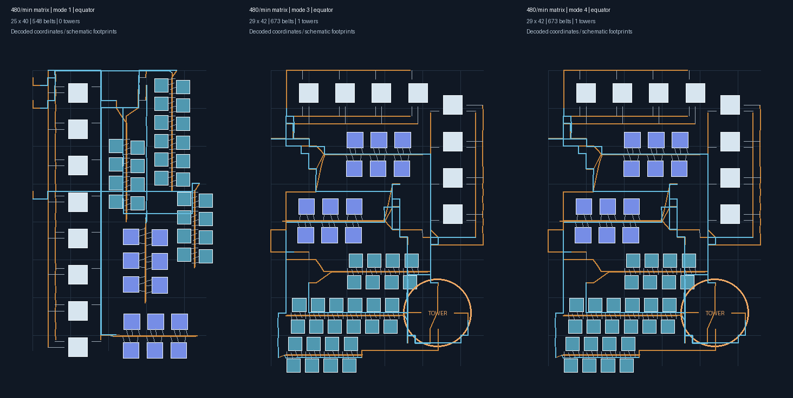
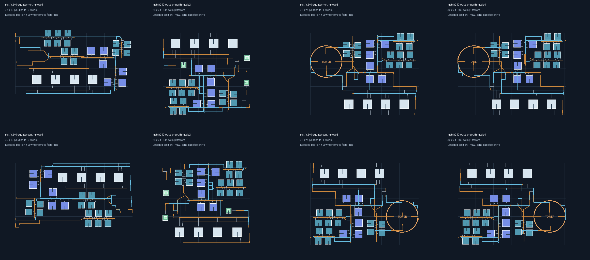
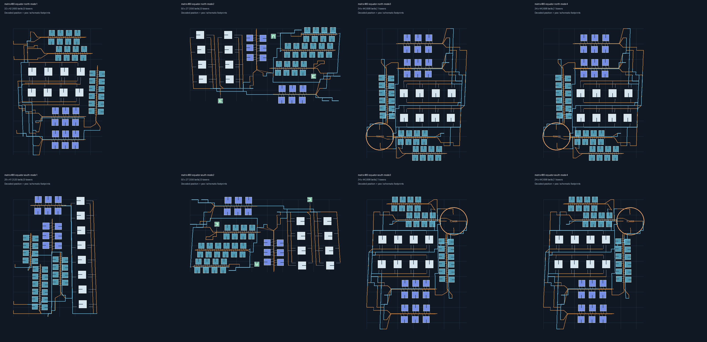

# 回退后的分阶段验收

2026-11-05，以用户清理后的工作区重新开始。HEAD 为 `651718d`；保留暂存区中的普通塔/配送器共享布局和左侧原料入口改动。上一轮被清理的五档纬带、极区候选与间距补丁不恢复。

每阶段先完成限定范围的修改、生成、解码和图片复核，再单独提交。未验收阶段不能标成完成；离线校验不能替代游戏内拍建。

## 阶段一：锁定回退后的矩阵基线（已完成）

请求：电磁矩阵 480/min，超密度、赤道中心、不喷涂、三级传送带、四级分拣器。保留默认供电与研究站堆叠配置。

| 模式 | 原生区域包络（格） | 机器实体 | 塔数 | 带段数 | 带线长度 |
| --- | --- | --- | --- | --- | --- |
| 直连传送带 | 25×40 | 64 | 0 | 548 | 731.7 m |
| 行星物流塔 | 29×42 | 64 | 1 | 673 | 861.4 m |
| 星际物流塔 | 29×42 | 64 | 1 | 673 | 861.4 m |

三种模式均完整生成并通过严格解码与校验和检查。塔库存只配置铁矿、铜矿、矩阵；中间材料直接连接生产线。图片按解码后的实体坐标和真实带连接绘制，未出现伸出紧凑厂区的大段原料输入长尾。机器轮廓为示意图形，不能用于断言游戏碰撞已通过。



回归检查固定64台生产机器、塔模式一塔且没有中间品库存，并限制最长边不超过50格、包络不超过1500格²、长宽比不超过2。阈值留出候选调整空间，不要求每次输出完全相同的带段数。

本阶段新增回归测试、绘图脚本和证据说明，未改生成算法。样例保存在 `build/matrix-restart/`，该目录为本地生成产物。

### 复现

在应用根目录运行（绘图使用 Python 和 Pillow）：

```powershell
$env:DSBOX_BLUEPRINT_TEST_OUTPUT = Join-Path (Get-Location).Path 'build/matrix-restart'
go test ./helper/blueprint/build/algorithm -run '^TestDenseMatrix480Equator$' -count=1 -v -timeout=3m
python scripts/blueprint/render_matrix_regression.py build/matrix-restart
Remove-Item Env:DSBOX_BLUEPRINT_TEST_OUTPUT
```

不设置环境变量时仅运行回归，不写任何蓝图或图片。导出文件 `matrix480-mode1/3/4.txt` 可用于后续游戏实测；同名 JSON 供诊断绘图使用。

## 阶段二：赤道南北边缘正交朝向（已完成离线验收）

从 `bce8a75` 继续。旧方案把整张已完成蓝图刚体旋转到所选纬度，240/min矩阵样例的生产机器和塔偏离正交方向约3.2°～4.7°。

赤道南北边缘改为保持纬向行和建筑朝向，依据源/目标纬度的横向物理格长补偿X坐标。补偿围绕厂区中心进行，纵向线路可随纬度平缓偏移；高度和建筑朝向保持原值。塔与配送器比较0°/180°两个正交排向，直连模式保持左侧原料入口。每个候选重新执行碰撞、分拣器角度/跨度、真实cargo偏移与供电检查，不以倾斜布局作为回退。

验证范围：电磁矩阵240/min、480/min，各含南/北边缘和直连、配送器、行星塔、星际塔四种模式，共16组；均未开启喷涂。各组机器偏离正交方向均小于0.001°，生产机器数与完整量化计划一致，所有塔模式均为1塔且只配置铁矿、铜矿和矩阵。建议点的区域包络贴合所选边界，导出记录在建议点及声明安全范围两个端点均重新通过离线几何检查。

| 产量 | 模式 | 北边缘包络 | 南边缘包络 |
| --- | --- | --- | --- |
| 240/min | 直连 | 34×19 | 35×19 |
| 240/min | 配送器 | 28×24 | 28×24 |
| 240/min | 行星塔 / 星际塔 | 32×24 | 32×24 |
| 480/min | 直连 | 32×42 | 29×41 |
| 480/min | 配送器 | 50×27 | 50×27 |
| 480/min | 行星塔 / 星际塔 | 34×44 | 34×44 |

480/min赤道中心基线仍为直连25×40、塔模式29×42且1塔。边缘模式需要补偿横向格距，也可能选择不同的可建候选，包络不要求与中心完全相同。图片中每排依次为直连、配送器、行星塔、星际塔；上排北边缘，下排南边缘。方形及方向标记使用导出记录的真实Yaw，建筑轮廓仍为示意。





验收命令：`go test ./... -count=1 -timeout=6m`（通过，算法包43.8秒）、`go build ./...`。本阶段不改变赤道中心、中纬、高纬、普通模式及纬带选项。当前证据仅覆盖上述矩阵案例，未宣称任意配方均已验证或游戏实测通过。

复现边缘样例和图片：

```powershell
$env:DSBOX_BLUEPRINT_TEST_OUTPUT = Join-Path (Get-Location).Path 'build/equator-edges-after'
go test ./helper/blueprint/build/algorithm -run '^TestDenseEquatorEdgeOrientation$' -count=1 -v -timeout=4m
python scripts/blueprint/render_matrix_regression.py build/equator-edges-after --pattern 'matrix240-equator-*-mode*.json' --columns 4 --output matrix240-edges.png
python scripts/blueprint/render_matrix_regression.py build/equator-edges-after --pattern 'matrix480-equator-*-mode*.json' --columns 4 --output matrix480-edges.png
Remove-Item Env:DSBOX_BLUEPRINT_TEST_OUTPUT
```

## 阶段三：五档定义与前两档位置接入（已完成离线验收）

五档原生区间已建立并通过全覆盖测试；第1档沿用已验收生成，第2档新增南北半球各自的中心、南边缘、北边缘。旧选项保持原半球与位置含义。第2档48组矩阵样例通过，四张对照图已复查，塔模式均为1塔且中间材料直接输送。详细区间、适配范围和复现命令见[第2档分区验收](第2档分区验收.md)。

该阶段尚未接入第3～5档，不能视为已完成五档整体交付；第3档的后续进展见阶段四。

## 阶段四：第3档25格窄环（已完成矩阵离线验收）

接入第3档两半球的中心、南边缘、北边缘，旧高纬键兼容为各自极侧边缘。修复窄环错误限制经向搜索长度的问题，保持纬向不超25格。塔候选比较17/21格内部预算；直连与配送器保留独立接线余量。

240/min、480/min共48组矩阵样例通过，最大纬向包络21格；塔模式均为1塔，配送器模式均为3个边界配送器。图片检查发现并拦截了配送器数量回退，已把数量检查扩展到前三档。详情与最终图片见[第3档分区验收](第3档分区验收.md)。

## 阶段五A：第4档失败复现与诊断检查点（第4档未交付）

第4档接入试验未通过。240/min直连曾通过六个位置，但480/min直连和塔/配送器样例仍存在失败，不能开放为可用档位。试验入口、布局和间距改动已撤下，运行代码保留已验收的前三档，仅增加分拣器角度诊断。

失败原因、可重复的未通过补丁和下一步实施边界记录在[第4档失败复现](第4档失败复现.md)。这是研究检查点，不是第4档完成验收。

## 后续阶段（未完成）

1. **第4～5档和高纬生成**：按档位逐个推进，限制纬向包络；第5档圆心环单独设计，不把一条窄纬带当作整个极区。每档验收后提交，失败案例留在对应阶段。
2. **监测器和综合验收**：沿实际传送带方向复核流速检测器；测试矩阵240/min、制造台30/min（硅石原矿）、运输船60/min及抽查案例，保存各档位三个位置的证据。核对单塔容量不足时增加塔的行为。

后续每阶段都重跑480/min基线，并人工查看其导出图片。塔数量或占地回退时先解决回退，不继续叠加新功能。
