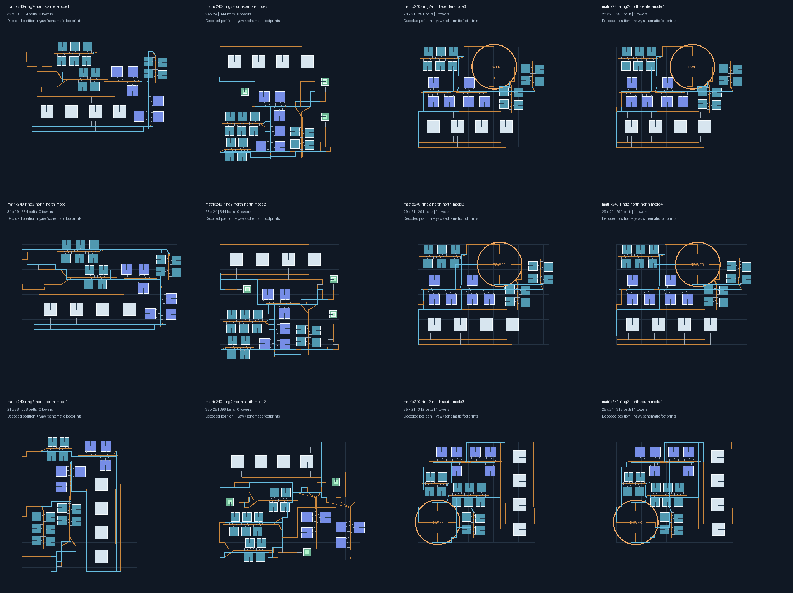
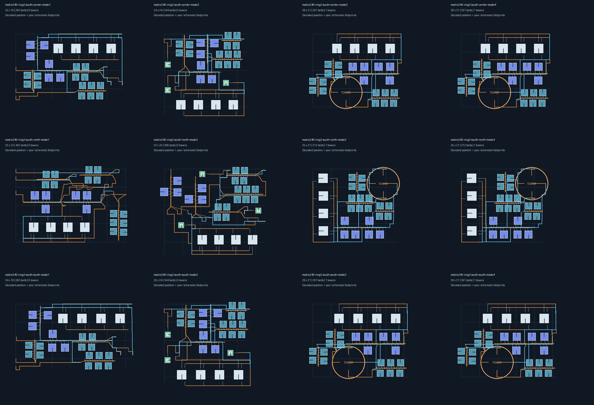
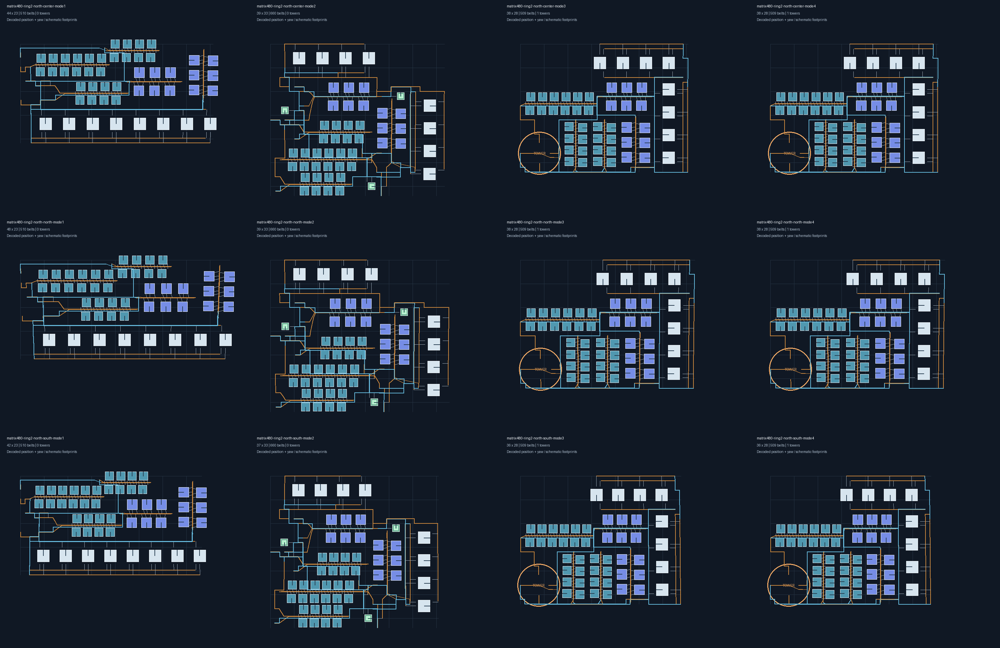
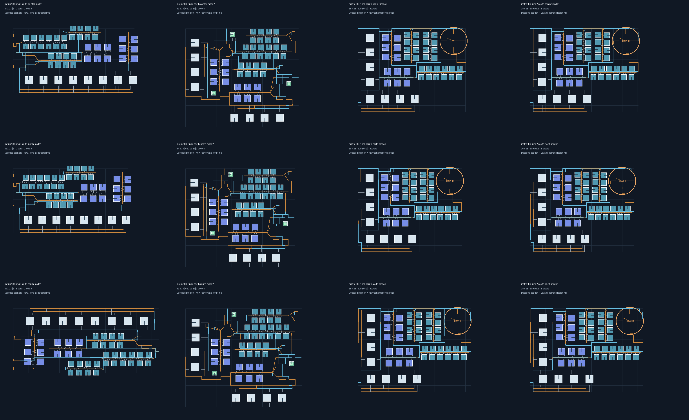

# 五档定义与第2档分区验收

从提交 `92f1b54` 继续，范围限定为五档区域定义、旧选项兼容及前两档的实际位置接入。

## 区域规则

档位从赤道向两极划分，依据原版200分段星球的原生纬带表，南北半球对称。南边缘、北边缘始终按地理方向解释；南半球的北边缘是靠近赤道的一侧。

| 档位 | 北侧纬向格索引 | 南侧纬向格索引 | 区域构成 | 本阶段状态 |
| --- | --- | --- | --- | --- |
| 第1档 | -80～80，跨赤道 | 同一区域 | 161行，1条原生纬带 | 保留中心与南北边缘生成 |
| 第2档 | 81～130 | -130～-81 | 每半球50行，1条原生纬带 | 接入两半球各3个位置 |
| 第3档 | 131～155 | -155～-131 | 每半球25行，1条原生纬带 | 定义完成，生成待接入 |
| 第4档 | 156～180 | -180～-156 | 每半球25行，1条原生纬带 | 定义完成，生成待接入 |
| 第5档 | 181～249 | -249～-181 | 每半球69行，8条原生纬带，构成极区 | 定义完成，需独立极区方案 |

测试检查-249至249共499个非极点纬圈恰好归属一个档位，并核对每条原生纬带的经度段数。第5档保留8条原生纬带，不能通过取第一条代替整个极区。

## 实现和兼容

- 选项显示档位、半球和位置。原 `equator` 及其边缘键继续有效；原 `north-mid` / `south-mid` 仍指向各自远离赤道的一侧，现在明确标注为第2档北/南边缘。新增第2档两半球的中心和靠赤道侧选项。
- 内部使用 `ring1-center/north/south` 和 `ring2-{north|south}-{center|north|south}` 规范键；旧键解析为同样的区域语义，不改写调用方请求。
- 第2档保持正交朝向并按纬度补偿横向格距。塔候选对中等规模厂也比较较低、较宽的内部直连方案，避免仅因原生纬带压缩而回退到多塔转发。
- 第2档南侧塔和配送器使用北侧原生格距装配作为对称候选，再映射回请求的南侧位置，并完整复验碰撞、线路、供电和分拣器能力。直连模式保持左侧输入，使用本半球装配。目标环宽和最终半球均未改变。
- 第3～5档的新规范键尚未开放生成；原高纬选项保持原行为，等待下一阶段替换。未宣称高纬或极区已适配完成。

## 验收结果

电磁矩阵240/min、480/min，不喷涂，三级带、四级分拣器，默认供电与堆叠配置。两半球×三个位置×四种运输模式×两种产量，共48组完整生成并严格解码。

- 每组生产机器实体数与量化计划一致，机器/塔偏离正交方向小于0.001°。
- 24组塔模式均为1塔，塔库存只含铁矿、铜矿和矩阵，中间材料直接输送。
- 最大纬向包络高度33格，小于第2档50格环宽；最大包络面积1287格²，最大长宽比约2.13。第2档回归允许不超过2.2的比例以容纳横向格距补偿；第1档仍保持原2.0限制，最长边和面积限制未放宽。
- 中心位置的包络中心靠近本环中心；边缘样例距所选边界不超过4格，没有退回另一半球或赤道。
- 解码后的实际记录在建议锚点、声明安全范围的两个端点再次执行静态/动态几何、带距离、分拣器跨度及供电校验。
- 第一、二阶段的赤道中心和边缘回归继续保留。检查证据属于离线验证，尚未进行游戏拍建；制造台、运输船及其它配方的综合覆盖仍是后续阶段任务。

图片各列依次为直连、配送器、行星塔、星际塔；各行依次为中心、北边缘、南边缘。轮廓为示意，位置、朝向和带连接取自导出记录。

最终检查：`go test ./... -count=1 -timeout=6m` 通过，算法包142.4秒；`go build ./...` 通过；四张对照图均已复查。









## 复现

在应用根目录运行：

```powershell
$env:DSBOX_BLUEPRINT_TEST_OUTPUT = Join-Path (Get-Location).Path 'build/latitude-tier2'
go test ./helper/blueprint/build/algorithm -run '^TestDenseSecondTierMatrix$' -count=1 -v -timeout=5m
foreach ($rate in @(240,480)) {
    foreach ($hemisphere in @('north','south')) {
        python scripts/blueprint/render_matrix_regression.py build/latitude-tier2 --pattern "matrix$rate-ring2-$hemisphere-*-mode*.json" --columns 4 --output "matrix$rate-$hemisphere.png"
    }
}
Remove-Item Env:DSBOX_BLUEPRINT_TEST_OUTPUT
go test ./... -count=1 -timeout=6m
go build ./...
```

生成的TXT蓝图与JSON记录位于 `build/latitude-tier2/`；目录为本地生成产物。完整回归仍包括旧选项、区域覆盖、赤道占地和单塔直连检查。
