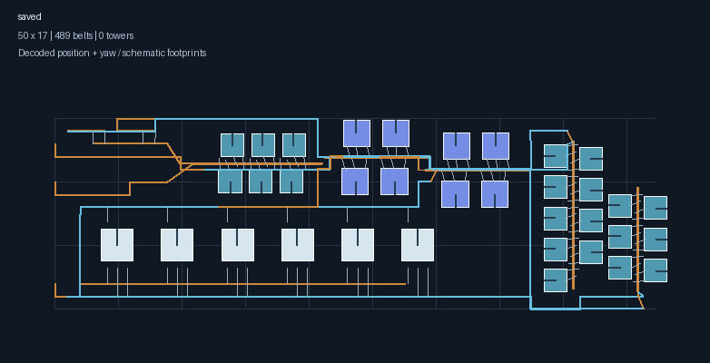
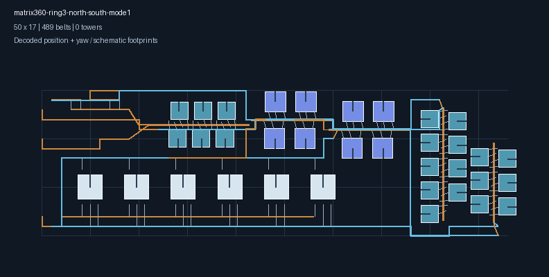

# 第3档360/min矩阵实测反馈修复

复现文件：[用户原图](第3档360矩阵-用户原图.txt)。用户确认该文件对应“偏角太大”的游戏截图，并要求保持当前方向。请求为电磁矩阵360/min、第3档北半球南边缘、直连传送带、未喷涂；从原图识别到一级传送带与一级分拣器。此前分档回归主要使用三级带和四级分拣器，缺少这个实际组合。

## 原因与修正

原图声明的可用光标范围只有133～134格（北纬47.88°～48.24°），没有覆盖所选南侧边界131格。离线按真实记录复验131、132格时，制造台第三输入臂会触发偏角错误，包括137、179号分拣器。截图没有记录精确光标纬度，因此不将离线复现点强行等同于用户当时的点击位置。

修正包含三项：

1. 第3档制造台的第三输入臂端点抬升降低0.01层。独立物料带仍位于0.3125层，真实货物采样目标保持原定义；动态建造盒、取货窗口和运输能力仍完整检查。
2. 指定第3档边缘时，装配的原生锚点优先靠近该边缘；完整候选择优也优先实际边界距离，再比较占地和线路。不再因某个向环内退让的方案面积更小，就覆盖用户的位置选择。供电在该原生候选位置规划和验证。
3. 对照本机游戏 `BuildTool_BlueprintPaste.CheckBuildConditions`，保留24°端点偏角、30°姿态差上限，删除余弦比较中会放行微小超限角度的额外容差。新增测试确认24.005°不能被当作合法24°。

核对的 `Assembly-CSharp.dll` SHA256 为 `ef314425dade51f529f184f07be136cd3c2660a6a81515603c7226fbe7ab1d8c`，与项目碰撞目录来源一致。反编译仅用于本地核对，未提交游戏源码。

## 修复版

[下载修复版蓝图](第3档360矩阵-修复版.txt)。原图保留用于回归，不被覆盖。导入修复版后保持原方向，光标可放在第3档北半球南侧边界；导出说明中的纬度指蓝图光标，不是整厂几何中心。

| 项目 | 原图 | 修复版 |
| --- | --- | --- |
| 区域包络 | 50×17 | 50×17 |
| 传送带 | 489段，一级 | 489段，一级 |
| 分拣器 | 94个，一级 | 94个，一级 |
| 生产机器实体 | 47台 | 47台，型号/配方/排向一致 |
| 感应塔 | 6座 | 6座 |
| 已验证光标纬圈 | 133～134 | 131～136 |
| 已验证光标纬度 | 北纬47.88°～48.24° | 北纬47.16°～48.96° |





图片使用蓝图实际坐标、朝向和线路绘制，建筑轮廓为示意。保留机器排列方向，仅调整必要的端点和纬度格距，未用升级设备、扩大包络或增加物流设施绕过问题。

## 验证

- 保存用户原图为固定测试输入，确认在131、132格触发原偏角问题，避免通过放宽规则掩盖故障。
- 360/min一级配置完整生成、严格解码，并检查原机型/配方/朝向、蓝图光标、原生120经度段数和50×17包络。
- 修复版在131～136每一个声明纬圈重新执行几何、带路、分拣器跨度、覆盖供电与内部单网检查。
- 增加同地区240/min、480/min一级配置回归；前三档既有布局、单塔和三个边界配送器回归继续运行。
- `go test ./... -count=1 -timeout=8m` 通过（算法包242.0秒），追加光标/元信息检查通过，`go build ./...` 通过。最终导出实体记录与全量回归一致。

以上为离线验证和生成图片复查。修复版尚待游戏内重新拍建验证，不将模拟检查写成游戏实测通过。

复现修复版导出：

```powershell
$env:DSBOX_BLUEPRINT_TEST_OUTPUT = Join-Path (Get-Location).Path 'build/third360'
go test ./helper/blueprint/build/algorithm -run '^TestDenseThirdTierMatrix360$' -count=1 -v -timeout=3m
Remove-Item Env:DSBOX_BLUEPRINT_TEST_OUTPUT
```
