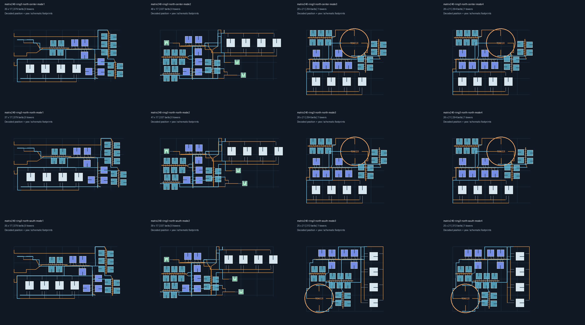
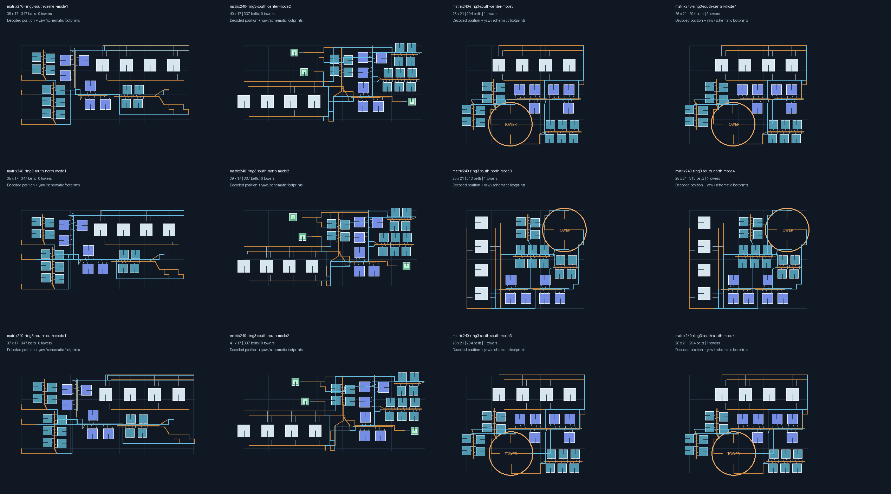
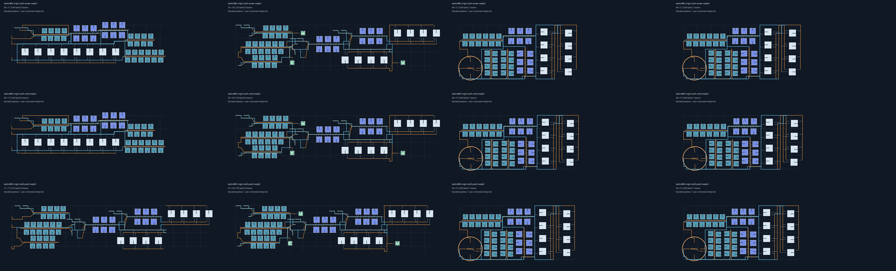
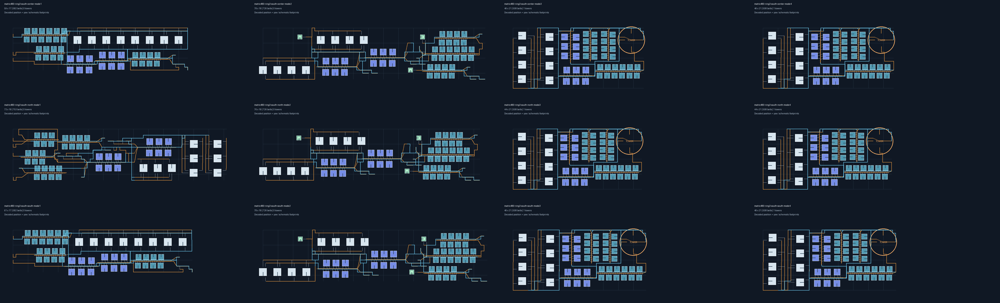

# 第3档25格窄环验收

从提交 `e09fe9f` 继续。北侧范围131～155格，南侧范围-155～-131格，每半球25格，原生经度段数120。本阶段接入中心、南边缘、北边缘六个位置；旧 `north-high` / `south-high` 继续表示各自远离赤道的一侧。

## 生成调整

原空间搜索把受限的纬向高度同时用作经向长度预算，窄环中的合法长矩形会被误拒。本阶段严格限制纬向高度，经向搜索预算由实体总占地估算，不再把整个厂区锁进17×17格的框。

第3档允许容量预检使用完整25行，移除重复扣除的边缘余量；几何、分拣器、带距离、供电与实际货物采样仍完整校验。容量允许25行不等于任意25行布局均可建造。

塔候选比较17格和21格内部预算，给线路保留不同余量。直连和配送器使用17格内部预算，以保留左侧原料接口和3个外部配送器。南侧设施复用北侧对称装配后映射回所选位置，所有最终建筑保持正交朝向。

第1、2档的既有占地回归保持原阈值。第3档按用户要求允许经向延长，以原生环宽、1800格²包络上限及55%空白比例上限检查矩阵样例，不套用赤道2:1的长宽比限制。

## 结果与证据

电磁矩阵240/min、480/min，不喷涂，三级带、四级分拣器和默认供电/堆叠。两半球×三个位置×四种模式×两种产量，共48组：

- 生产机器数与量化计划一致，机器和塔的正交偏差小于0.001°。
- 24组塔样例均为1塔，库存只有铁矿、铜矿和矩阵，中间材料直接输送。
- 12组配送器样例均为3个边界配送器；该数量检查同时覆盖第1、2档，避免为缩短包络而引入逐物料转发。
- 最大纬向包络21格，最大包络面积1404格²，最大空白比例约40.2%。实际经向长度随产量与模式变化，480/min配送器样例仍可能达到78格。
- 建议点位于所选中心或边缘。边缘样例允许最多向环内退4格，实际可放置起点以导出说明的已验证范围为准，不承诺越过该范围仍可拍下。
- 严格解码后，在建议锚点及已声明安全范围的两端重新检查几何、运输距离、分拣器跨度和供电。

480/min北侧中心的塔方案由初始61×17格压到46×21格，保持1塔。配送器以少设施和内部直连为前提保留接线余量，不用增加配送器数量换取更短的矩形。

检查记录：全量 `go test ./... -count=1 -timeout=8m` 通过（算法包211.4秒）；最终配送器修正后追加前三档28组配送器专项，全部通过（105.2秒）；普通模式共享设施及预算检查通过；`go build ./...` 通过。图形轮廓为示意，位置、朝向和线路来自导出记录，尚未进行游戏拍建实测。

各图从左到右为直连、配送器、行星塔、星际塔；从上到下为中心、北边缘、南边缘。









## 复现

```powershell
$env:DSBOX_BLUEPRINT_TEST_OUTPUT = Join-Path (Get-Location).Path 'build/latitude-tier3'
go test ./helper/blueprint/build/algorithm -run '^TestDenseThirdTierMatrix$' -count=1 -v -timeout=5m
foreach ($rate in @(240,480)) {
    foreach ($hemisphere in @('north','south')) {
        python scripts/blueprint/render_matrix_regression.py build/latitude-tier3 --pattern "matrix$rate-ring3-$hemisphere-*-mode*.json" --columns 4 --output "matrix$rate-$hemisphere.png"
    }
}
Remove-Item Env:DSBOX_BLUEPRINT_TEST_OUTPUT
```

TXT蓝图及JSON记录保存在本地 `build/latitude-tier3/`。第4、5档、流速检测器方向，以及制造台、运输船和抽查配方的综合验收仍未完成，后续分阶段推进。
