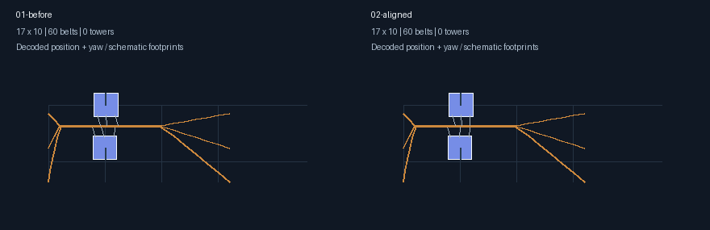
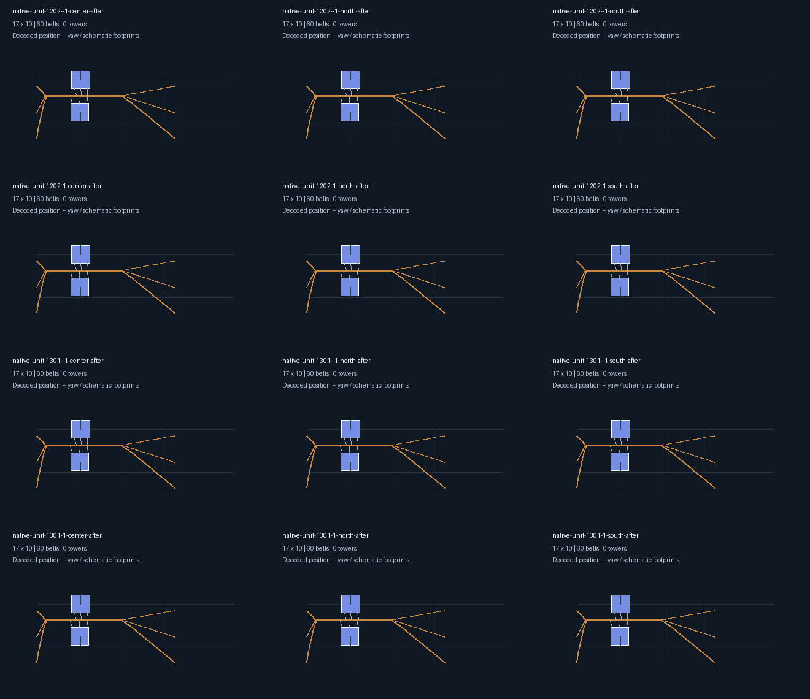

# 第4档局部端口适配验收

本阶段从 `2cc222b` 继续，完成局部机器单元的原生端口适配。**第4档整厂生成尚未接入，用户选项仍不开放。** 第3档360/min修复及此前分档生成逻辑保持原行为。

## 改变了什么

先将双机单元放到第4档的真实原生坐标，再读取制造台 `SlotPoses`，把第三输入臂的带侧端点沿对应物料轨道方向对齐到机器槽位。同时调整该臂的货物采样目标，在原同物料轨道内重新绑定节点和offset。

不修改机器位置、传送带位置、机器/臂朝向、臂高度或建筑数量。仅处理已标记的制造台第三输入臂；原双层轨道和其它臂保留。电路板双机单元在北侧南边缘（锚点156）的原姿态会触发约24.4°的端点偏角；对齐后通过原24°限制，没有放宽阈值。

适配要求实体与最终记录处于同一原生单Area坐标，拒绝过期记录、区域段数不匹配、跨纬带包络和已经进行整厂重定位的记录。全部检查通过后才提交；失败时恢复端点、引用、采样偏移、诊断和验证状态。重复对齐已适配单元不会累积位移。

## 验收覆盖

| 维度 | 范围 |
| --- | --- |
| 单元 | 电路板、磁线圈，各2台制造台 |
| 运输设备 | 一级带/一级臂、二级带/二级臂、三级带/三级臂、三级带/四级臂 |
| 排向 | 0°、90°、180°、270° |
| 地区 | 第4档两半球的中心、南边缘、北边缘 |
| 原生网格 | 200主分段、100经度段数，每侧25格环宽 |
| 组合数 | 2×4×4×2×3＝192 |

192组均通过机器/臂/带几何、分拣器跨度能力、实际货物取放窗口与最终连接槽重放检查。另验证了故障带路时的完整回滚、旧坐标记录拒绝及重复对齐的幂等性。启用导出时，12个一级设备、0°排向试样经过编码、严格解码和解码后几何/连接槽复验。

完整回归 `go test ./... -count=1 -timeout=8m` 通过（算法包245.6秒）；补齐四级设备及最终连接槽检查后的局部专项通过；`go build ./...` 通过。前三档当前入口没有调用新的局部适配函数。

## 图片与试样

前后对照左侧为原单元，右侧为原生端口对齐后。17×10包络、2台机器和60段带均保持不变；单元保留独立输入输出测试接头，不能将该试样包络当作整厂面积指标。





- [电路板双机端口试样](第4档电路板双机-北半球南边缘端口试样.txt)
- [磁线圈双机端口试样](第4档磁线圈双机-北半球南边缘端口试样.txt)

这两个文件只用于第4档北半球南边缘的局部端口复验，建议光标锚点156（北纬56.16°）。它们没有完整产业物流和供电，需要外接原料与电力。当前只完成离线检查，尚未游戏拍建实测。

## 复现与下一步

```powershell
$env:DSBOX_BLUEPRINT_TEST_OUTPUT = Join-Path (Get-Location).Path 'build/native-units'
go test ./helper/blueprint/build/algorithm -run '^TestNative' -count=1 -timeout=3m
python scripts/blueprint/render_matrix_regression.py build/native-units --pattern 'native-unit-*-after.json' --columns 3 --output accepted-units.png
Remove-Item Env:DSBOX_BLUEPRINT_TEST_OUTPUT
```

下一阶段必须先在目标原生坐标中完成单元放置，再调用端口适配；随后剪去测试接头、连接跨单元线路、补电并复验整厂。不能把局部通过直接推广为第4档整厂可用，也不能直接对已经变形的成品布局调用本函数。第4档矩阵、制造台和运输船等整厂验收仍未完成。
