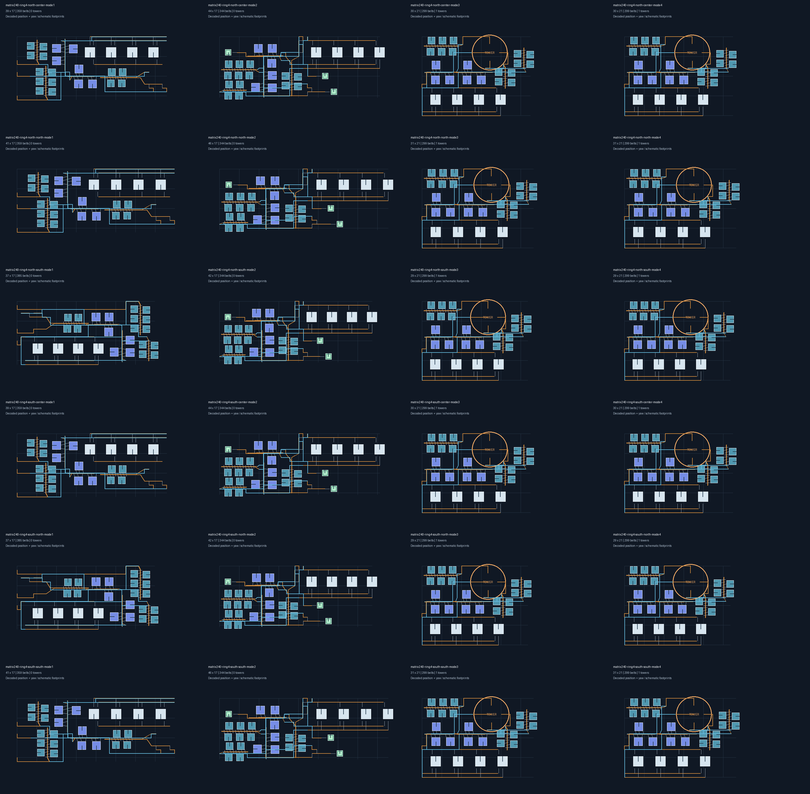
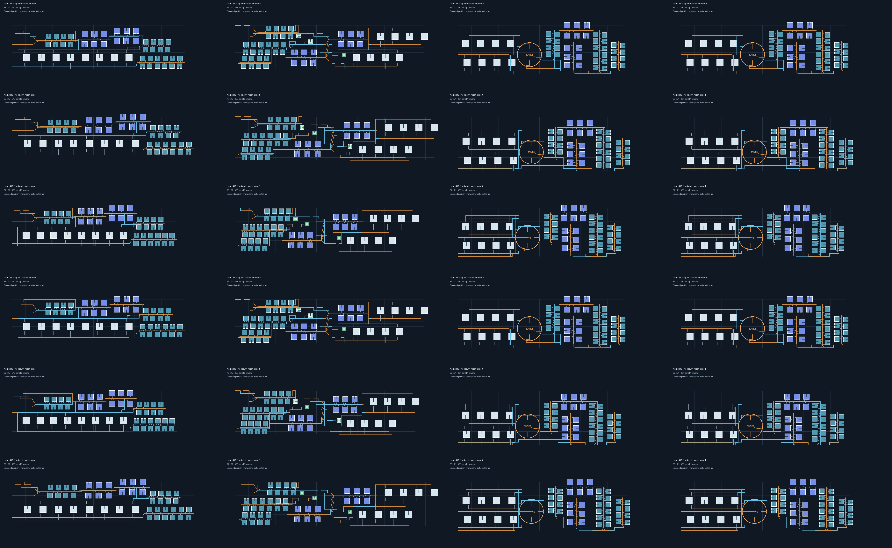
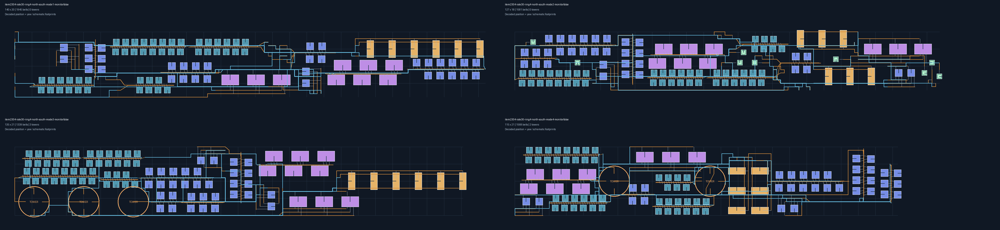
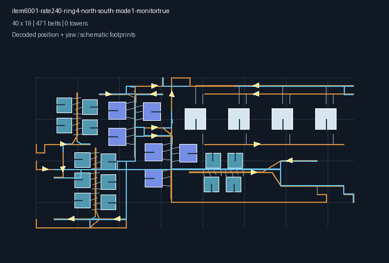

# 第4档整厂与监测器验收

2026-11-08，在 `6bc4680` 的经纬度选择器和预览协议改动之上接入。第4档新增两半球的中心、南边缘、北边缘，仍限定本档25格纬向包络。第5档尚未接入，运输船60/min尚未通过；本记录不是五档总体完成声明。

## 实现

- 在目标原生纬度中补偿经向格距；机器保留正交朝向，不再通过整图倾斜适配高纬。
- 补电前对参考臂和普通机器长臂搜索最小端点调整，保留实际物料带和货物offset。按真实槽位重放角度、跨度、臂盒、带节点及静态碰撞。使用实测跨度重新核算能力；任一步失败回滚实体、参数、取货引用和诊断。
- 高纬化工双排局部增加0.3格行余量和0.15格周期余量。配送回退候选按较长跨度规划并联臂，不升级分拣器；最终仍按各实体真实跨度检查聚合流量。
- 1.5格自由长带的重采样提前计入经向补偿，防止补偿后超过游戏接线长度。副产物西侧出口按实际补偿后的步长检查。
- 为最终固定坐标重新验证连续光标范围，范围端点也独立复查。不能将“北边缘/南边缘”理解为任意纬度都能放置。
- 流速检测器旧实现复制宿主记录Yaw，而 `byPath` 的默认Yaw不保证代表有向带链。现在从真实前后连接计算输送切线，球面记录按当地切线计算；同步宿主与检测器后重新进行几何检查。

## 已通过的离线检查

第4档每个场景覆盖两半球各三个位置、直连/配送器/行星塔/星际塔四种模式，共24组：

| 场景 | 组数 | 设备配置与约束 |
| --- | ---: | --- |
| 电磁矩阵240/min | 24 | 三级带、四级分拣器、无喷涂 |
| 电磁矩阵480/min | 24 | 同上 |
| 电磁矩阵240/min，开启流速监测 | 24 | 同上，真实方向复核 |
| 制造台Mk.II 30/min完整原料链 | 24 | 硅石作为原矿，禁止石矿制硅石 |
| 抽查：电路板120/min | 24 | 完整原料链 |
| 抽查：磁线圈120/min | 24 | 完整原料链 |

合计144组。每组均严格解码，检查生产机器数量、正交朝向、25格限宽、边缘距离及声明范围两个端点。矩阵塔模式均为1塔，仅铁矿、铜矿和矩阵使用塔槽；矩阵配送模式均为3个配送器。

另有96组局部设备等级/朝向/位置回归、事务回滚和重复适配检查；前三档480/min的28组布局及用户360/min一级物流反馈案例通过。原360案例仍在第3档北半球南边界131格起放，包络不超过50×17。

`go test ./... -count=1 -timeout=12m` 通过，算法包111.2秒。末尾新增端点区域检查后重跑局部端口与监测器回归通过。`go build ./...` 和前端 `npm run build` 通过。前端已有Sass弃用和较大资源块提示。本次无Wails绑定签名变更。

这些是离线原型/几何/能力检查和导出记录检查，**没有进行游戏内放置实测**。原生地形、已有场景实体和科技状态不在证明范围内。

## 导出图与样例

图中机器外形为示意，位置与Yaw来自导出记录；已补齐炼油、化工等机器，避免把未绘制的机器误当作空白。检测器用黄色箭头表示真实方向。









144组蓝图与索引在[第4档验收样例.zip](第4档验收样例.zip)。样例说明含建议光标纬度和已验证范围，保持默认排向放置。命名中 `item6001` 为矩阵，`item2304` 为制造台Mk.II，`item1301` 为电路板，`item1202` 为磁线圈；`mode1/2/3/4` 对应直连/配送器/行星塔/星际塔。

复现：

```powershell
$env:DSBOX_BLUEPRINT_TEST_OUTPUT = Join-Path (Get-Location).Path 'build/native-factory'
go test ./helper/blueprint/build/algorithm -run 'TestLatitudeAcceptance|TestEstablished|TestNativePort|TestMonitor' -count=1 -timeout=12m
python scripts/blueprint/render_matrix_regression.py build/native-factory --pattern 'item6001-rate240-*-monitorfalse.json' --columns 4 --output fourth240.png
Remove-Item Env:DSBOX_BLUEPRINT_TEST_OUTPUT
```

## 仍未通过的需求

运输船60/min的默认完整原料链有937台生产设备，当前第4档直连与星际塔试验均因布局/路由搜索超时失败。未更改用户设备等级、外供中间品或目标产量来包装成功。扩展验收通过 `DSBOX_EXTENDED_LATITUDE_ACCEPTANCE=1` 启用，`TestLatitudeAcceptance/item5002` 重现；该组没有计入上面的144组通过数量。

第5档含多个原生纬带，尚未实现圆心环整厂布局，也未开放为可用选项。后续需解决极区多Area布局与复杂大产线的线路容量；总体目标保持未完成。
