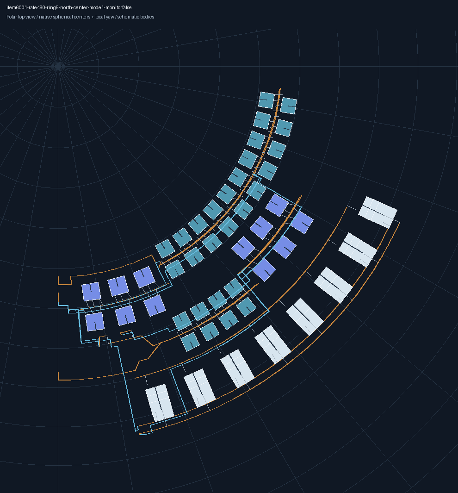
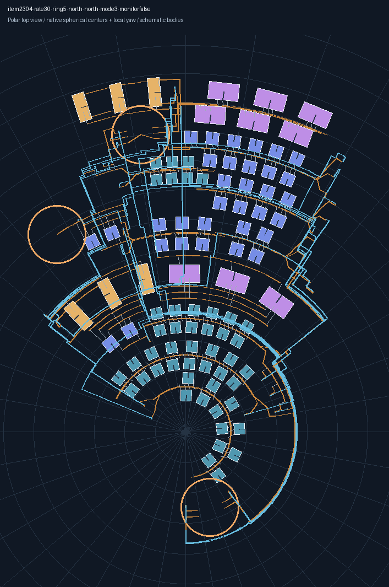
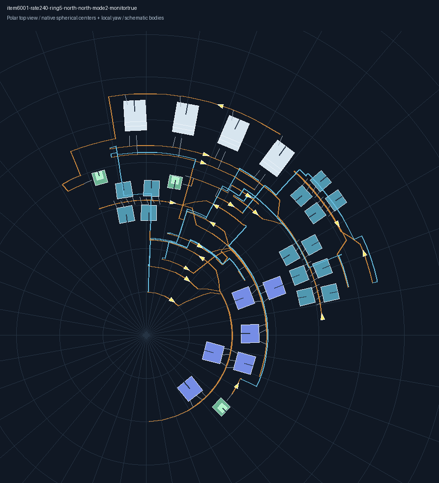

# 第5档极区整厂验收

2026-11-09。接入第5档北极区、南极区的中心、南边缘、北边缘，五档共27个位置选项。极区覆盖本档全部原生子环，按实际球面落位与接线，不再把外侧单个子环冒充整个极区。

## 实现与边界

- 在布线前固定球面坐标，完整单元按当地格距定位并进行实体避碰；生产建筑保持当地经纬方向的正交Yaw，Pitch、Tilt为0。沿纬线排列的建筑在俯视图中呈弧形。
- 跨子环使用共享路由坐标，写出时换算为原生主Area坐标与完整区域父链；独立检查换算及半周旋转前后的世界位置，误差小于0.001米。
- 原生分拣器端点联合选择合法组合；货物只在原物料轨上重标定，保留设备等级、完整生产数量和吞吐核验。
- 极区物流塔独立落位，保留真实最小塔距；内部中间品继续直连。矩阵塔模式为1塔，配送模式为3个边界配送器。
- 局部过长带段补入真实节点并同步所有路径和货物轨引用；自由直带采用1.5格重采样，并按当地米制带长限制收紧。
- 监测器选点、方向和收尾检查使用同一球面坐标，消除已完成球面排布后仍用平面审计的混用。
- 大厂候选搜索覆盖完整纬向范围；极区重排预算随单元数分配，仍受原有总时限约束。

## 已通过的离线案例

每项覆盖两半球、三个位置、直连/配送器/行星塔/星际塔四种运输模式，各24组，共144组。配置为原版200分段行星、三级传送带、四级分拣器、无喷涂；保留量化方案的生产设备和完整原料链。

| 案例 | 组数 | 额外检查 |
| --- | ---: | --- |
| 电磁矩阵240/min | 24 | 完整生产数量、矩阵最少边界设施 |
| 电磁矩阵480/min | 24 | 同上，避免入口长尾与设施数量回退 |
| 电磁矩阵240/min，开启流速监测 | 24 | 真实有向带链、监测器实体与朝向 |
| 制造台Mk.II 30/min | 24 | 硅石原矿输入，禁止石矿制硅石 |
| 抽查：电路板120/min | 24 | 完整原料链 |
| 抽查：磁线圈120/min | 24 | 小产线不偏离所选中心或边缘 |

每组严格解码导出串，检查本档包络、目标中心/边缘、生产设备数量、正交朝向、真实物流设施数量和声明起点。对导出记录重新执行静态盒、动态臂、带连接、货物、能力和供电检查。中心不接受远离中心的子环回退，边缘包络距所选边界不超过4格。

前三档480/min基线、第3档北半球南侧360/min一级物流反馈、第4档144组整厂案例、各级局部端口及事务回滚也进行了回归。

这些结果属于离线原生规则核验，尚未进行游戏内铺设实测。地形、现场已有实体及玩家科技状态不在本次证明范围内。

## 蓝图与图片

[第5档验收样例.zip](第5档验收样例.zip)含144份蓝图、严格解码记录、索引和验证日志。`index.json`列出地区、建议起点、包络、建筑数和每份蓝图的SHA-256。

文件名中的`item6001`为电磁矩阵，`item2304`为制造台Mk.II，`item1301`为电路板，`item1202`为磁线圈；`mode1/2/3/4`依次为直连、配送器、行星塔、星际塔。

保持默认排向，按蓝图说明中的建议起点放置。起点范围可能只有一个纬圈；“北边缘/南边缘”指整厂包络的位置，光标位置以导出说明为准。

下图按导出记录的真实球面中心和当地朝向绘制，建筑轮廓为示意；黄色箭头为流速监测器方向。

## 未通过的案例

运输船60/min的默认完整链包含937台生产设备。第5档北极区中心、星际塔模式仍未通过，较小包络不能完整落位，较大包络在总时限内未完成。该项没有计入144组通过数，也未通过提升生产设备等级、改成外供中间品或降低产量来替代原请求。

运输船的完整五档验证及游戏内铺设验证仍是未完成项，因此本记录不构成总体目标完成声明。

## 验证与清理记录

清理前执行了`go test ./... -count=1 -timeout=15m`，全项目通过，算法包456.339秒；前端`npm run build`通过。清理后执行`wails build -s -skipbindings -m -nosyncgomod`，Windows打包通过，输出`build/bin/DysonSphereBox.exe`。具体日志保存在样例包。前端构建有现存的Sass弃用及资源块大小提示。

按本次收口要求清理开发用`*_test.go`、失败试验、重复样例、分析日志及临时生成目录，保留本记录、有效蓝图包、图片与可复用绘图脚本。上面的测试命令是执行记录；清理后可通过应用导入样例及索引中的建议位置复验。
