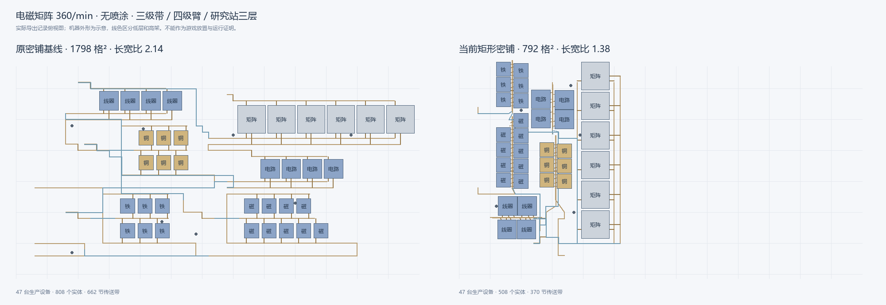

# 全场矩形密铺实现与验收

## 2026-11-10：容量分组、真实分流器与统一交付侧

本节记录本轮源码更新；后面的 v5 数值与旧选区表保留为历史证据，不代表当前策略。游戏内放置和持续产量仍需实测，离线几何、流量证明与编译检查分别计量。

| 当前机制 | 实现与限制 |
| --- | --- |
| 原料容量优先 | 同物品按配置满负荷毛需求合并入口；先比较完整消费者分组，必要时以真实分流器和独立合流缓冲分配份额。另有优先填满单带能力的机器分组候选，减少均分造成的零散余量。 |
| 产物分流 | 单产物且无机器回流、自产剂回流的多去向出货，比较独立真实分流树。保留机器进出料臂，仅替换带间二次过滤；多产物过滤及优先回流沿用原结构。三出口树对 2—81 个去向使用最少的 `floor(N/2)` 个分流器。 |
| 分流器三形态 | 物品均为 2020，模型为 38、39、40。读取各自真实槽位、旋转与高度；建立原生槽点、向外 1.1 米过渡及离壳带头。不同形态不能只替换模型编号。 |
| 完整体积 | 保留游戏原生细分建造盒检查，另用完整选择体积作为明确的保守净空，覆盖实际带段和经端点修正、拉伸后的动态臂盒。排布、锚点选择及每个公布起点使用同一规则；短接头例外需证明真实槽位、方向、层高和连接。 |
| 成品归口 | 普通与超密度直连均按物品、真实带容量合并交付尾带，出口引回原料入口所在西侧，使用独立端点。目标和副产物分开交付；共享出口监测器按合计净产量设置期望值。 |
| L/U 折行 | 同一生产身份的两个或三个真实短 run 可组成凹形单元，保持机器、臂及槽位的刚体关系，角内空隙继续参与全场填充。与直线布局独立比较，未形成真实折角或未通过接线、供电、球面检查的候选不输出。 |
| 塔布局 | 保留最少实际塔及真实十二口预算；同时比较共享进出塔带、短过滤接头、整体平移压缩和独立产物分流树。新候选按带长条惩罚的面积与实际带长共同择优，不强制采用更大的布局。 |
| 路线成本 | 源接头、主路、目标接头和已复用尾链统一计价；高层长线与越出原实体包络的外绕承担额外软代价。保留必要跨越，不以硬截高度换取生成失败。 |
| 研究站供电 | 独立块内有效堆叠链按底层接电中心补电；跨块、断链、循环或错配方不视作合法堆叠。高层配送器仍按其真实三维位置检查覆盖。 |

三形态已与本机游戏 `0.10.35.29151`、Steam build `25955035` 的 DLL 和资源重新核对。下面是本轮用于保守排布的**选择体积**，单位为米、顺序为局部 X/高度/Z；它不是对原生细分碰撞盒的改写。

| 模型 | 形态与带口 | 保守选择体积 |
| --- | --- | --- |
| 38 | 四向同层 | 2.70 × 2.40 × 2.70 |
| 39 | 平行双层 | 2.00 × 2.94 × 2.70 |
| 40 | 交叉双层 | 2.70 × 2.96 × 2.70 |

模型 39、40 的高口比地面高约 1.3333334 米，属于一个传送带高度；不能与整个分流器约 2.666667 米的堆叠间距混用。槽口本身在模型中心附近，槽点与过渡点是两个不同的真实带实体，不能再用统一“一格口距”同时构造和验证。

1600/min 电磁矩阵、无喷涂、一级机器/分拣器及三层研究站的固定量化配置保留 210 台生产设备。其原料配置毛需求为铁矿 3220/min、铜矿 1620/min；允许的入口数按所选带速计算，不能用升级分拣器的结果冒充仅升级传送带。

| 传送带 | 单带容量/min | 铁矿入口 | 铜矿入口 | 原料入口合计 | 成品交付口 |
| --- | ---: | ---: | ---: | ---: | ---: |
| 一级 | 360 | 9 | 5 | 14 | 5 |
| 二级 | 720 | 5 | 3 | 8 | 3 |
| 三级 | 1800 | 2 | 1 | 3 | 1 |

关键实现入口：

- [三形态原型与不同用途的体积](../../helper/blueprint/build/placement/splitter.go)、[共同真实接头构造](../../helper/blueprint/build/algorithm/splitter_gate.go)。
- [容量优先候选](../../helper/blueprint/build/algorithm/dense_capacity_candidates.go)、[生产出货分流树](../../helper/blueprint/build/algorithm/dense_producer_split.go)。
- [西侧共享交付](../../helper/blueprint/build/algorithm/mode1_delivery.go)、[真实折行单元](../../helper/blueprint/build/algorithm/dense_bent_rows.go)。

本轮负例检查包含错误模型/槽位/层高、带等级降级、无关来源混入、删掉真实交付端点、规范份额篡改，以及原分流器四角的无关带侵入。布局仍是有限候选搜索，不宣称数学全局最优；折行或更多分流器本身不构成密度收益。

三级带、一级臂、三层研究站、无喷涂监测的最新直连样例如下，所有成品回口及分流接线均计入总带长：

| 电磁矩阵产量/min | 生产设备 | 包络格面积 | 全部带长/米 | 原料口 / 成品口 |
| --- | ---: | ---: | ---: | --- |
| 1500 | 197 | 2948（44×67） | 3201.586 | 3 / 1（1500/min） |
| 1600 | 210 | 2835（45×63） | 2178.151 | 3 / 1（1600/min） |

1600 样例的优化前包络为 4004 格²，当前减少约 29.2%；原来的成品出口分散，当前带长包含新增的西侧统一交付成本。1500 的真实 L/U 候选也能通过完整检查，但占地大于本次获选布局，因此没有强制替换更紧凑的方案。

独立 NumPy 复算不调用生成器几何验证器：1500 的公布起点仅为原生格 `-33`；1600 为 `-36…-11`，共 26 点，均检查了完整带段、其它静态盒、真实动态臂 OBB 与槽位。旧 `-38/-37` 起点的毫米侵入及旧臂盒交叠反例已拒绝。覆盖口径是所声明的 R200、单 Area、原生整数起点与默认方向，不是任意非栅格位置或游戏地形、既有实体和运行时 Mod 的建造保证。

## 历史阶段：2026-11-04 v5

> 2026-11-04 后续游戏实测发现中纬带靠高纬侧放置失败，并提出最少设施及1.5倍长带要求。当前正在实施 `dense-v6-blackbox-paste-longbelts`，进度与证据见[修复与黑盒优化记录](../超密度蓝图生成器问题/修复与黑盒优化记录.md)。下文为v5阶段自动验收记录，不能视为上述新问题已通过游戏验收。

更新时间：2026-11-04。当前规则版本：`dense-v5-global-latitude`。状态：生成器开发与自动验收完成，游戏内放置及连续运行按用户分工交由用户实测。

用户后续明确的目标是紧凑矩形内的真实设备与线路压缩。超密度不再让每条产线独占一个矩形，也不能用无效传送带降低空白率。四种公开模式保持各自运输身份；真实游戏测试仍由用户进行。

### v5 机制

| 要求 | 实现 | 边界 |
| --- | --- | --- |
| 紧凑矩形 | 四向实际轮廓搜索，优先长宽比不超过 2 的可行结果；长机器链在容量组内均衡细分 | 有界搜索不宣称数学全局最优 |
| 取消区块独占 | 只保留机器、分拣器和局部带的必要相对关系；轮廓内空隙可被其它集合利用 | 不能移动已完成跨集合接线的孤立实体 |
| 连续密铺街道 | 容量分组保持独立物料身份，机器沿连续低轨折排；喷涂、检测与设施接驳按实际轮廓加入同一占位场 | 真实附件及供电必要间隙计入完整面积，不从统计中剔除 |
| 直连带 | 单去向独立产物直接出货，多去向保留过滤；从最近实际边界接入原料后统一布线 | 内部回流保留真实优先门和毛流证明 |
| 多去向过滤 | 存在真实可压缩单产物组时，额外比较主带两侧交错抓取；各去向保留独立节点和所选等级的实际过滤臂 | 不使用普通带 T 分流；普通回收门保留原结构，自产剂反馈另计毛流；旧可行候选保留 |
| 配送器 | 机器核心与各箱体/臂/短尾分别选址后布线，自产剂保留真实回料臂 | 副产物保留必要原料侧回收关系 |
| 两种物流塔 | 跨产线共享兼容物品/供需角色库存，保留真实塔距和十二口预算，机器填入塔间空隙 | 不假设机队运行能力或混用供需角色 |
| 参考机器密度 | 使用原图低层带、双端姿态和独立重复周期：熔炉 2.45、制造 3.15、化工 6.68 格；三物料制造额外行距降为 0.4，化工用四分之一周期错位及 0.04 余量 | 必须区分局部机器阵列、完整功能区和整厂，不用其中一项替代其它验收 |
| 原型适配 | 基础/高级白名单逐项核对实际建造盒和槽位 | 不推断未知 Mod 型号或其它游戏版本 |
| 喷涂与监测 | 校验先喷涂后取料；监测器必须有同向真实平直宿主和足够净空 | 低轨夹缝不强塞监测器，必要时使用短地面直线 |
| 分拣偏移 | 重建源货物曲线目标，再按新带方向和实际采样重新绑定 | 不直接沿用偏移符号，不跨物料重绑或越界夹取 |
| 建造区域 | 后端提供五个友好区域，完整矩形只在选定原生纬带内校验 | 放不下时明确失败，不暗中移到赤道 |

普通配送和普通环塔重构保留独立流程；普通直连带不采用上述密铺排布。

### v5 计量口径

固定目标、产量、设备等级、带/分拣器等级、堆叠、喷涂、监测器和放置条件后才比较。旧直连产物位于 `build/density-layout-review/baseline.json`：电磁矩阵 360/min、无喷涂、三级带、四级臂、研究站三层，共 47 台生产设备。

- `EnvelopeArea` 是原生 Area 的包络格面积，不是实际地表面积。
- `EnvelopeAspectRatio` 用于判断是否仍是长条。
- `BeltCount` 是最终真实传送带数，不按逻辑 lane 重复计数。
- `TotalBeltLengthMeters` 是最终世界坐标中全部带间连接的唯一弦长，包含局部、外部与共享带；不是货物曲线的精确运行距离。
- `InternalBeltLength` 与全部带长分开记录。
- `BlankRatio` 包含传送带投影，不能作为机器密度证明。超密度排序在形状/包络之后减少总带长和带数，不奖励传送带填空。

参考全图跨纬度，不能直接用其原始 Area0 的 XY 与新图格面积当作物理面积比较。应在统一局部投影中比较相同机器集合的建造盒包络、同排/跨排近邻距离，并将研究站地面列与堆叠层分开。

2026-11-04 当前源码重新生成的电磁矩阵对照如下。两者均为 360/min、无喷涂、三级带、四级分拣器、研究站三层，含 47 台生产设备；不能将此设备设置冒充界面一级带/一级臂默认值。

| 最终记录指标 | 原密铺基线 | 当前全场密铺 |
| --- | ---: | ---: |
| 包络面积（格²） | 1798 | 792 |
| 包络长宽比 | 2.138 | 1.375 |
| 实际传送带（节） | 662 | 370 |
| 全部实体 | 808 | 508 |

面积减少约 56%，带数减少约 44%。当前总带长 421.51 米，独立运行生成用时约 1.5 秒。记录位于 `build/density-layout-review/baseline.json` 与 `dense-final.json`。图中机器外形仅为示意，不是游戏截图。

3600/min 扩大用例保留 470 台机器，最终 6027 实体、7684 格²、长宽比 1.662、4651 节带/5502.91 米；最终整套验证中生成约 16.8 秒。优化只复用不随试探位置变化的连接身份，并按完整整数高度层延迟构造源接驳，保持候选路径、几何检查和获选结果不变。端口全量/分层等价、真实端点旋转代价与 25 秒整厂生成门槛均有独立回归；耗时不是所有硬件的保证。

本地参考图的三个同源配方按 30 台、三级带/四级臂、无喷涂监测单独比较，当前直连生成的机器核心结果如下。密度比为原图同数量窗口投影包络除以当前投影包络；原图坐标重建采用明确的主区域锚点 0 假设，不能替代其未知的实际粘贴位置。

| 设备 / 配方 | 当前机器投影包络（m²） | 参考窗口（m²） | 机器密度比 |
| --- | ---: | ---: | ---: |
| 量子化工厂 2317 / 配方 35 | 1225.931 | 1196.153 | 97.6% |
| 重组式制造台 2318 / 配方 108 | 532.680 | 549.313 | 103.1% |
| 负熵熔炉 2319 / 配方 61 | 373.422 | 383.687 | 102.7% |

这张表只比较生产机器，不包含外围物流、供电、喷涂和监测占地。13 台等带余数的矩形折排、不同配方的多输入变体及低等级分拣器，会有不同的容量分组和额外间距；不能把上表推广成所有组合均达到 95%。完整产物同时记录包络、实际带数和总带长，避免只报局部密度。

电磁矩阵 360/min、四点加速喷涂及监测、三级带/四级臂、研究站三层、明确赤道选区的同条件对照如下。只在比较基线中移除新增双侧过滤候选，其余流水线相同；真实建筑记录指纹确认公开搜索确实选中该候选。

| 完整工厂指标 | 旧单侧过滤候选最优值 | 新公开获选结果 |
| --- | ---: | ---: |
| 矩形尺寸 | 85×44 | 57×40 |
| 包络面积（格²） | 3740 | 2280 |
| 长宽比 | 1.932 | 1.425 |
| 实际传送带（节） | 3210 | 3010 |
| 总带长（米） | 4028.345 | 3810.368 |
| 跨层连接 | 407 | 494 |
| 最高带节点原生 Z | 7 | 9 |

面积减少 39.04%，带长减少 5.41%，但更紧凑的布线使用了更多跨层连接及更高的局部带路。15 个供剂去向、15 根四级过滤臂均保留；供剂出货子系统实际长轴从 65.415 降至 50.415 格，没有把初步估计当作实际结果。同一主带节点上布置两根反向臂会冲突，因此实现使用相邻不同节点交错抓取。证据与两份严格编解码蓝图位于 `build/dense-matrix-street-tradeoff/`。

### v5 简单建造选区

| 界面选项 | 键 | 原生纬向细格范围 | 经度分段 |
| --- | --- | ---: | ---: |
| 赤道附近（最宽） | equator | -80…80 | 200 |
| 北/南半球中部 | north-mid / south-mid | 81…130 / -130…-81 | 160 |
| 北/南半球高纬 | north-high / south-high | 131…155 / -155…-131 | 120 |

范围来自原版 200 分段表。`SurfaceLayout.latitudeZone` 强制受限球面模式并关闭邻带扩展；候选锚点、完整矩形与最终 Area 均再次核验。结果显示区域名和具体建议锚点，用户无需手输纬圈索引。

前端在旧后端没有区域目录时阻止超密度请求及导出；返回区域与请求不符时不替换旧结果。工作区保存并校验选区。区域变化只使几何结果失效，普通模式和原量化设置保留。复制和导出的蓝图说明同样保留地区、建议南/北纬起点和默认整张粘贴方向，离开应用后仍能查看。

已通过五区×四模式小型铁块工厂的 20 次实际生成和严格解码；原生边界、南北对称、未知值/越区/超高拒绝、工作区地区保存、前端类型/生产构建及无 GUI 契约检查也通过。大型工厂在窄带不因此被承诺可用。

### v5 密铺机制与验证边界

同张单次蓝图的原版预览会跳过分拣器与非分拣器之间的预览碰撞。密铺路由据此取消旧分拣器 XY 粗矩形禁行，保留静态机器、真实带节点合并和最终臂间检查；这不代表任意已有世界实体均可互穿。

原图三类设备的 12 根样本臂均已按显式裁切边界重建货物采样。独立 float32 探针与当前 float64 计算的最大位置差约 0.000026 米；不是 Unity 实测或任意浮点边界的位级等价声明。

原图混带并非简单合流，还包含分离、限速、旁路与闭环整形，并依赖未记录在蓝图中的玩家科技。当前独立物料变体不能声称与原图的混带吞吐完全等价。

已经补上最终逐台复核：在全部裁剪和 cargo 重绑之后重新核对机器数量、真实臂与并联能力、每种物料的有向输入/输出及每台喷涂机供剂。删除输入臂、删除输出臂、错过滤、反转输入带以及切断单台喷涂供剂都由变异测试证明会失败。重绑后也会重新执行动态几何检查，不复用旧引用的缓存。

监测器也在最终存活实体上核对：机器原料/产物轨道以及直连独立外供段必须由实际同区、同点、同向的监测器覆盖。删除所需监测器、换宿主、换过滤或尝试关闭临时开关绕过均被拒绝；合法同段复用保留。当前开关生成的是默认流量监测器，没有配置报警速率阈值，不能将物料/计划速率证明写成已配置报警阈值。

参考原文件在 2026-11-04 再次完成严格解码、强制重编码和逐建筑/区域记录对照，18069 个实体及 4 个区域保持一致，SHA256 仍为 `8f6ef87ef8eeef70e998b4e1f23d4b5259759a4b5e7b684717ef032bf1d94492`。本机 Go 1.25.10 / Windows amd64 只读编解码探针总计约 0.133 秒、Go 累计分配约 112.4 MiB、测量结束时堆分配约 15.1 MiB；这些不是模型预览、游戏运行或进程峰值 RSS 的测量。记录见 `build/dense-final-reference/codec-performance.json`。

连续街道核心已接入四种模式的实际外围运输、喷涂、检测和供电。局部 30 台机器核心已出现接近来源窗口的结果；外围接驳仍计入完整面积与带长。增加必要附件时，一些更密机器阵列会使用更长带路，因此必须同时保留完整成本与候选取舍，不能仅凭机器核心密度声称整厂更优。

同一物料兼作配方原料和喷涂供剂的两条真实输入已完成分流。例如二级增产剂 120/min、一级加速喷涂时，一级增产剂拆成原料 240/min 与供剂 30/min，规范总输入仍为 270/min；四模式及普通/密铺监测组合均有实际生成回归。满负荷能力也按两条真实带分开：3 台设备的原料 337.5/min 与供剂 42.1875/min 各小于一级带 360/min，不再把两者错误相加而多拆成 2+1；四模式一级带/一级臂均验证保留一个真实原料组。

已保存用于用户实测的三个直连样例到 `build/dense-delivery/`：默认等级无喷涂、高等级无喷涂、高等级喷涂与监测。每张蓝图携带建议建造位置，`manifest.json` 保留设置、实际成本及文件指纹。游戏放置与连续运行由用户实测；数值和结构检查不冒充游戏验收。

### v5 自动验收

2026-11-04 09:07 的最终版本完成以下检查。测试前后 255 个相关 Go 源文件指纹相同，没有把修改前的整套结果当作修改后的证明。

| 范围 | 当前证据 |
| --- | --- |
| 矩形、设备等级与规模 | `TestDenseAcceptanceMatrixDefaults`、`TestDenseAcceptanceMatrixScale`；实际解码重新统计机器、带数、米制总带长和 Area 包络 |
| 同源机器密度、转向与货物偏移 | `TestDenseAcceptanceSourceRecipes`、`TestReferenceCargo*`、`TestReferenceThirdPortCounts` 及保存的来源窗口计量 |
| 四模式喷涂、监测及回流 | 完整街道附件、配送、塔及自产剂/回收用例；各输出仍经共同最终规则 |
| 多去向分流 | `TestDensePairedFiltersLevels`、`TestDensePairedOutputsExplicitMatrix` 及同条件完整对照；保留各去向、所选臂级别与主带总容量 |
| 同物料双用途与低级带 | `production_input_roles_test.go`；270/min 规范总量、240/30 角色份额、3 台共用真实原料根及各级设备不升级 |
| 逐台完整性及监测器缺失 | 最终机器、喷涂、监测变异测试拒绝删除、错向、错误过滤及关闭临时开关绕过 |
| 简单选区及越区拒绝 | 五区×四模式实际生成、区域边界、塔高度、工作区保存与最终描述核对 |

执行结果：

- `go test ./helper/blueprint/... ./helper/factory/... ./service/factory/... -json -count=1 -timeout=12m`：通过。124 项顶层测试及 907 个子用例通过，算法包约 464.5 秒。默认跳过的两项按需研究探针另有 Pareto 与同条件对照产物，不将跳过计作通过。
- `go build ./...`：通过。
- 在 `frontend` 目录运行 `npm run build`：Vue/TypeScript 检查及 Vite 构建通过；保留现有大于 500 KiB 分包提示。
- 生成的 Wails 类型与组件声明差异已核对；本次修改的 Go 源码格式及手写文件差异空白检查通过。

完整日志与源文件指纹见 `build/dense-delivery-integration.jsonl`、`build/dense-delivery-source-before.json`、`build/dense-final-verification.json`。未操作游戏或应用 GUI，不宣称已经通过游戏放置、地形适配或稳态产能实测。
