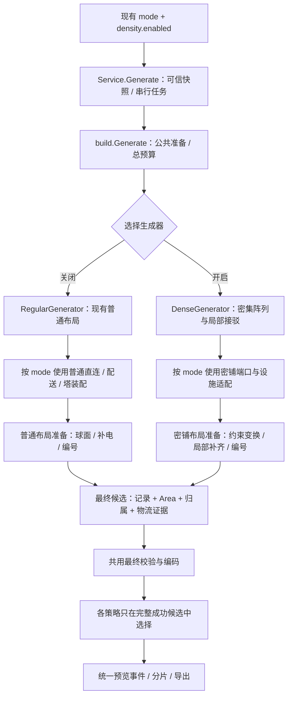

# 普通与密铺生成器对比及适配器设计

日期：2026-11-03。  
代码基线：`b1b1e769a9c54a48f3690bedaa5c9996d5a289c2`。  
检索方式：本轮使用 `codegraph explore` 定位符号、调用关系及当前磁盘源码；下述行号以该基线为准。  
状态：架构决策与后续 agent 实施指引，尚未修改生成器实现。

## 1. 明确结论

**需要在生成层设置策略接口，提供普通生成器和密铺生成器两种实现。继续保留同一个 Wails `Service.Generate` 与 Go `build.Generate` 入口。**

这里的“两种生成器”是内部生成策略，与 UI 中的四种运输模式是两个维度：

```text
生成策略：普通生成器 / 密铺生成器
运输模式：机器直连带 / 物流配送器 / 行星内物流塔 / 星际物流塔
球面设置：自动球面 / 旧平面兼容
```

现有 `mode=1..4` 保持含义；`density.enabled` 决定内部生成器。用户在任何现有模式都可以启用密铺，不新增第五种“密铺运输模式”。

采用三个明确边界：

1. **公共生成入口**：可信数据、请求生命周期、守恒物料图、总预算和最终结果发布。
2. **普通/密铺策略**：各自负责机器、局部运输、模式设施和球面候选的装配与选择。
3. **公共最终检查与编码**：验证最终建筑和真实物流证据，编码、自解码，再输出结果。

普通生成器先包装当前逻辑。密铺生成器拥有独立的几何候选与局部接驳流程，按需复用现有设施、容量和几何函数。两者无需复制量化器、游戏格式编解码器或 Wails 服务。

“生成器”在这里指纯引擎内的布局/装配策略，不是新建一个服务层完整业务工作流。

## 2. 为什么不只改一个间距参数

当前源码和参考数据之间的差别已经落在多个层面：

| 关注点 | 当前普通路径 | 密铺参考及设计要求 |
| --- | --- | --- |
| 机器排列 | `buildLine` 以一种类型固定朝向、统一横向间距生成单排 | 双排关系、朝向组合、随行位置变化的 ΔX、不同 ΔY 周期 |
| 初始中心步长 | 熔炉 3、制造台 4、化工 7+1，另加用户间距 | 化工主行约 6.662120～7.144805；制造台约 3.332884～6.895720；熔炉约 3.704395～4.019345，均为原始局部口径 |
| 机器行间关系 | 完整机器行连同带/臂/设施装配后再平移靠拢 | 制造台约 3.400/3.045～3.056，熔炉约 2.800/2.3168，机器和窄行间接驳共同设计 |
| 初始带路 | `straight` 每步 XY 增减 1，Z=0 | 代表接驳样本带 Z≈0.125/0.500，ΔZ≈0.375，Y 基本重合 |
| 机器物料端口 | 每种输入/输出独立带；局部端口由普通槽位方案生成 | 样例 2,113 台机器全部一进一出，多原料配方也如此，独立输入变体需专门设计 |
| 主路线搜索 | 六邻居三维 A*，各轴步长 1，终点坐标精确匹配 | 块内小数位置与窄层间距需要专用接线；块外可接标准化过渡端口 |
| 收尾 | 平移、球面重排、补电、删冗余电杆、重编号与校验混在一起 | 密集关系必须保留；允许的修改由密铺策略控制，最终检查保持严格 |

这些差异说明应拆分装配策略，而不是扩大 A* 预算、缩小全局碰撞盒或给普通算法散布 `if density`。

表中普通初始步长与样例局部节距尚未统一到同一球面物理距离，不能直接据此计算面积节省。完整数值见[参考蓝图结构分析](参考蓝图结构分析.md)。

## 3. 普通生成入口的准确位置

### 3.1 前端到服务

| 位置 | 实际职责 | 调整方向 |
| --- | --- | --- |
| [`useQuantWorkspace.ts:201`](../../frontend/src/composables/dysonSphere/useQuantWorkspace.ts#L201) `generate` | 保存生成签名、取当前 plan、调用桥接、拒绝过期结果 | 签名与请求增加 density，继续使用同一生成方法 |
| [`factory.ts:45`](../../frontend/src/services/dysonSphere/factory.ts#L45) `generateFactory` | 创建 requestId、监听进度、调用绑定、分片读取大串 | 保留封装，不新增“密铺专用 RPC” |
| [`service.go:117`](../../service/factory/service.go#L117) `Service.Generate` | 原版数据集、公开 mode 1..4、球面设置、可信 plan 深比较与复制 | 继续做公共校验及能力入口，不在服务里计算坐标 |
| 同方法第 142、147 行 | 串行替代任务，调用 `build.Generate` | 两种生成器共享同一任务取消/接替机制 |
| 同方法第 155～167 行 | 大串临时令牌、取消复查、操作日志、响应 | 两种生成结果走同一路径 |

前端还检查 `LogisticsSummary.FlowGraphDigest` 与量化快照一致。因此密铺结果必须给出同一规范物料图的物流证据，不能只返回可解析的蓝图文本。

### 3.2 当前 `build.Generate` 不是纯分派器

定位：[`helper/blueprint/build/generate.go:201`](../../helper/blueprint/build/generate.go#L201)。

实际顺序：

```text
性能观察与参数校验
  → 球面/布局设置归一化
  → 整次生成 4 分钟截止时间
  → 加载数据集、验证版本与 plan
  → normalizeProductionRateBasis
  → newBuilder
  → BuildFlowGraphContext
  → 设备产能复核及模式能力限制
  → 按 mode 进入布局路径
  → 选出经过终检的成功结果
  → publishFinalBlueprintProgress
```

目前 `newBuilder` 在第 245 行，而物料图在第 253 行构建。引入策略接口时，应把图构建和真正通用的校验提升为准备阶段，**在任何普通 builder、普通拆行和局部几何装配之前选择生成器**。

可共享的是数据版本、守恒物料图、机器数与配方能力校验。第 272 行针对运输模式的机器回流限制属于能力规则，必须显式保留或迁入相应策略的能力检查；不能当作无关代码删除。

引擎内部仍保留 mode 5/6 分支，但公共服务只开放 1..4。策略重构不应顺带扩大公开支持范围。

## 4. 四种普通模式的真实调用链

### 4.1 机器直连带：先装机器行，再按物料边接线

主要定位：

- [`mode1.go:48`](../../helper/blueprint/build/mode1.go#L48) `generateConnected`
- [`mode1.go:164`](../../helper/blueprint/build/mode1.go#L164) `assembleConnectedVariant`
- [`mode1.go:183`](../../helper/blueprint/build/mode1.go#L183) `prepareConnectedRows`
- [`transport_plan.go:59`](../../helper/blueprint/build/transport_plan.go#L59) `planTransportRows`
- [`transport_router.go:108`](../../helper/blueprint/build/transport_router.go#L108) `routeTransport`

```text
generateConnected
  → 有限矩形/轮廓候选，每个候选创建独立 builder
  → assembleConnectedVariant
      → prepareConnectedRows
          → planTransportRows：容量拆行、流边分配
          → buildLine：机器、局部带、分拣器
          → coatSupply / 输入 stub / 回流与过滤输出
          → 完整机器块的矩形或轮廓装箱
      → routeTransport：接全部规范 lane
      → 裁掉无用尾带、监测器或供电处理
  → 每个候选 finish
  → 仅比较终检成功的候选
```

`planTransportRows` 同时做物料守恒边分配、普通单带容量拆行及 `transportRow` 建立，不是完全通用的物料接口。密铺可以复用相关算术与流边守恒规则，但不能默认接受普通行长和每物品单带的几何组织。

`prepareConnectedRows` 会添加至少 5 段输入 stub，按旧机器行生成过滤输出，并在连接准备后清空 `surfaceBlocks`，防止之后按独立块移动已连接的全图。密铺接入要保留“连成图后不能随意平移块”的不变量。

### 4.2 配送器：完整配送行作为装箱单元

主要定位：

- [`fly_layout.go:26`](../../helper/blueprint/build/fly_layout.go#L26) `generateFlyLayout`
- [`fly_layout.go:102`](../../helper/blueprint/build/fly_layout.go#L102) `assembleFlyLayout`
- [`line.go:106`](../../helper/blueprint/build/line.go#L106) `buildLine`

```text
generateFlyLayout
  → 有限列高/轮廓/交错候选
  → assembleFlyLayout
      → lineCounts
      → buildLine（内部会调用 flyBlocks 装配送设施）
      → 按含箱体、分拣器、电杆的完整行装箱
      → 副产物边界处理
  → 可选 pairFlySurfaceBlocks
  → 每个候选 finish
  → 选最优可行结果
```

这里的配送器并非一个完全后置的、只接端口的插件，它嵌入 `buildLine` 内。密铺生成器要使用配送语义，需要抽出基于明确端口的设施接驳能力，不能仅将 `buildLine` 替换为几台密集机器。

已有反向交错候选可以参考其独立候选和终检机制，但它移动的是已完成的旧机器行，不能自动产生参考图的密集双排。

### 4.3 行星塔与星际塔：主入口中内嵌组装

主要定位：

- [`generate.go:289`](../../helper/blueprint/build/generate.go#L289) 起的设施分支
- [`station.go:143`](../../helper/blueprint/build/station.go#L143) `attachStations`
- [`station_surround_packing.go:71`](../../helper/blueprint/build/station_surround_packing.go#L71) `finishSurroundStationLayouts`

```text
Generate 中的塔分支
  → 按规范生产顺序划分 zones
  → lineCounts
  → stationSurroundCounts / 副产物端口预算
  → buildLine，多行组成单/双塔组
  → coatSupply
  → attachStations
      → surroundStationRows：重新移动/旋转机器行
      → 塔物品槽与带端口分配
      → findPath 等局部寻路
  → finishSurroundStationLayouts
      → 封闭塔组有限装箱候选
      → 每个候选 finish
```

`attachStations` 在第 180 行主动调用 `surroundStationRows`，不是只在已有坐标上增加一座塔。密铺块如果直接传入，会被按普通塔组规则重新摆放。

因此塔模式的复用边界应该是塔配置、物品/端口分配、容量核验和可独立使用的接线路径能力；普通机器行环绕塔的摆法留在普通生成器。

## 5. 需要特别隔离的三处底层行为

### 5.1 `buildLine` 同时决定几何和部分模式行为

定位：[`line.go:106`](../../helper/blueprint/build/line.go#L106)。

- 第 139 行根据 `machineSpacing` 决定统一横向间距。
- 第 141 行将起点计算到整数格。
- 第 152 行使用 `straight` 创建机器两侧的地面带。
- 第 175 行附近按相同步长逐台放置机器，使用类型固定朝向。
- 第 226/233 行按普通带与槽位规划装配分拣器。
- 第 268 行进入配送设施装配。
- 末尾还进行机器端分拣器校验与产率标注。

**结论：将其整体保留为普通生成器的局部装配器。** 密铺使用自己的机器阵列和局部接线函数，按需要抽取容量、原型与真实槽位计算；不将整个方法改成大量密度分支。

### 5.2 三维寻路仍有单位步长和格点身份

定位：

- [`transport_router.go:389`](../../helper/blueprint/build/transport_router.go#L389) `findTransportPathWithinBounds`
- [`station_bridge.go:13`](../../helper/blueprint/build/station_bridge.go#L13) `beltCell`

当前邻居为：

```text
(-1,0,0), (0,1,0), (1,0,0), (0,-1,0), (0,0,1), (0,0,-1)
```

成功判断使用 `current.point == end`；占位键对 X/Y/Z 使用 `math.Round`。

从一个端点出发，仅靠这些整数增量，不能直接到达任意不同小数相位的端点。参考样本的 ΔZ≈0.375，以及不同小数 X/Y 端口都需要显式过渡。即便两个小数带点被分入不同占位格，格点模型也没有表达其真实窄间距。

密铺应采用：

```text
密铺块内的精确端口
  → 经验证的局部过渡结构
  → 满足旧搜索格点/高度约束的外围端口
  → 可复用的块外寻路
```

若无法形成可行过渡，则该候选失败，或在独立密铺局部路由器内求解。不要把 `beltCell` 全局改成更细网格，也不要直接将端点四舍五入后继续生成。

### 5.3 `finish` 具有布局副作用

定位：[`generate.go:493`](../../helper/blueprint/build/generate.go#L493)。

| 阶段 | 当前代码 | 对密铺的影响 |
| --- | --- | --- |
| 球面准备/整体归零 | `prepareSurfaceEncodingContext` 或 `shift`，约 509～520 行 | 可改坐标基准，必须确认保持样例的球面语义 |
| 锚点失败后的重试 | `prepareConnectedSurfaceEncoding` / `preparePackedSurfaceEncoding`，约 535～562 行 | 可能重排块并改写跨区连接 |
| 重新生成记录 | `records` / `applyRecords` | 覆盖坐标与编号，应用新的 Area 转换 |
| 供电修复 | `repairFinalPower`，约 568 行 | 增加实体，可能侵入密铺局部通道 |
| 电杆裁剪 | `pruneFinalPower`，约 584 行 | 删除实体，随后再次编号与映射 |
| 几何与连接规则 | `validateFinalPlanetRules`，627 行 | 应复用规则能力，检查状态必须对应本次最终记录 |
| 模式物流证据 | `validateStationTransport` / `recordFacilityTransport` / `finalizeLogistics` | 依赖 builder 的真实路线/设施状态 |
| 编码 | `blueprint.Encode`，662 行 | 应共享 |

后续 agent 必须把“准备/修复最终布局”和“只检查并编码最终布局”分开。不能让密铺生成器绕过校验，也不能让旧收尾步骤未经约束地重排密铺结果。

## 6. 推荐架构

### 6.1 统一入口、两个策略



“共享最终校验”仍在候选评估中执行。不能先按未验证的最小面积选中一个候选，再仅校验它一次；这会丢掉其他可行候选并改变普通生成行为。

### 6.2 最小接口建议

以下是拟新增的内部契约示意，当前不存在这些类型：

```go
// preparedGeneration 保存只读公共输入，不能携带普通机器行或旧 builder。
type preparedGeneration struct {
    request Request
    dataset *quant.Dataset
    graph   quant.FlowGraph
}

// generationStrategy 编排一种空间生成策略；只返回完整通过检查的结果。
type generationStrategy interface {
    generate(context.Context, preparedGeneration) (Result, error)
}

type regularGenerator struct{}
type denseGenerator struct{}
```

建议初版把策略接口与两个包装实现在现有 `build` 包内，使它们能够调用当前私有构建器方法。密铺的规则、几何候选和模板数据仍放在独立的 `helper/blueprint/density/` 子包；该子包不反向依赖 `build`。

只需要显式选择两种策略，不需要注册中心、反射、插件发现或依赖注入容器。

“只读”是代码约束，Go 结构体复制不会自动隔离其中的切片、map 和指针。公共 dataset/graph 只供读取；候选需要改写的记录、参数数组、连接和球面状态必须独立复制。模板数据不能被某次生成原地修改，失败候选也不能污染下一候选或已选中的结果。

### 6.3 `build.Generate` 的拆分落点

建议顺序：

```text
beginGenerationPerformance / 总 deadline
  → 公共设置与原版数据校验
  → normalizeProductionRateBasis
  → BuildFlowGraphContext
  → 通用机器数、配方与产能复核
  → 组装 preparedGeneration
  → density.enabled ? denseGenerator : regularGenerator
  → 策略内部能力检查、候选生成、校验和选择
  → publishFinalBlueprintProgress（只发布最终成功结果）
  → 收束性能快照
```

注意：

- 公共准备不创建 `newBuilder`，不执行 `lineCounts` 或 `buildLine`。
- `newBuilder` 移到普通策略或其候选创建阶段；密铺可按需使用共享记录工具，但不被迫采用普通中间状态。
- 通用产能复核可提取现有 `validateProductionCapacity` 的内容，保留其调用的可信量化验证。
- 模式、原型与回流等适用条件在策略能力检查中明确评估，保持原来的拒绝行为，除非新增能力有独立证据。
- `normalizeSetting` 内的通用等级/有限值检查可以共享；普通机器行参数只约束普通路径或密铺明确采用的选项，不能把普通默认间距当成密铺必需条件。
- `NormalizeCurrentLayoutSetting` 仍关闭旧混带设置。密铺不能隐式复活未公开的 mode6。

## 7. 两种生成器共享和独立的内容

| 能力 | 普通生成器 | 密铺生成器 | 复用方式 |
| --- | --- | --- | --- |
| 可信量化快照与守恒图 | 同一输入 | 同一输入 | 公共入口一次构建 |
| 普通单排与固定间距 | 沿用 | 不作为必经步骤 | 保留在普通策略 |
| 密集双排与小数相位 | 不运行 | 规则候选与余数单元 | 独立 density 子包 |
| 局部机器接驳 | 普通物料带与槽位布局 | 低高度带、相向机器、精确端点 | 复用原型/容量算术，装配流程分开 |
| 直连/配送/塔语义 | 保持现有 | 保持同一 mode 语义 | 按真实端口逐步抽设施适配函数 |
| 粗格 A* | 现有路线 | 仅用于可兼容的外围端口 | 接驳过渡明确验证后复用 |
| 球面与供电准备 | 原有候选与修复 | 保持密集关系的受限候选 | 共享几何运算，分别决定变换 |
| 连接编号与槽分配 | 现有记录策略 | 保留/分配槽位由来源决定 | 明确策略后复用，不能自动覆盖模板关系 |
| 最终物理规则 | 同一来源版本 | 同一来源版本 | 校准真实规则，不按密度降低标准 |
| 物流证据 | 现有 route / station / fly 记录 | 实际端口与路线证据 | 转换到共同终检输入 |
| 编码与 UI 输出 | 现有 | 相同 | 统一 codec、结果 DTO 与事件协议 |

关键是“同一语义，不一定同一装配函数”。例如 `attachStations` 会重排机器，不能仅因它名字叫“接塔”就直接复用。

## 8. 共同最终候选：避免两套结果标准

### 8.1 候选应携带的内容

建议在 `build` 内部定义最终候选契约，暂不暴露给前端：

| 字段组 | 内容 |
| --- | --- |
| 最终几何 | `[]blueprint.Building`、Areas、主 Area、拖选范围；已经完成最后一次合法变换 |
| 归属 | 产线绑定、机器绑定、共享设施、分区 |
| 球面依据 | 坐标空间、锚点、实际转换信息、规则版本 |
| 真实运输证据 | 规范 FlowEdge 到端口/带链/设施的绑定，净流、机器毛流、回流与供剂 |
| 密铺约束 | 哪些实体属于不可拆的局部单元，已选择的模式/规则 |
| 候选身份 | 完整请求与规则版本指纹、候选序号 |

运输证据应是带真实索引和物料身份的结构化记录，不能仅提供 `LogisticsSummary.Checks` 中的“passed”字符串。普通 builder 中的 `transportRoutes`、`stationLinks`、`flyEndpoints` 均需要映射；密铺也需提供相同意义的数据。

### 8.2 收尾拆成两个步骤

**步骤 A：策略专属准备。**

- 普通准备保留既有球面尝试、补电与裁剪顺序。
- 密铺准备只执行规则允许的变换和设施增删，失败回到密铺候选搜索。
- 完成最终 float32 转换、记录编号和全部证据索引更新。
- 准备结束后，后续检查不再移动或添加实体。

**步骤 B：共用最终检查和编码。**

1. 最终记录有限值、编号、Area 与引用一致性。
2. 真实连接槽按记录顺序重放，确认无连接覆盖。
3. 球面姿态、静态盒、动态物流占位、塔间距与供电。
4. 规范物料边到真实端口/路线的闭合与容量检查。
5. 归属完整性、机器数和密度指标。
6. `blueprint.Encode` 与严格自解码。

每个候选都要完成这两个步骤才参加结果排名；对失败候选只记录诊断，不发布蓝图预览分块。

### 8.3 当前 `records()` 的适配陷阱

定位：[`primitives.go:354`](../../helper/blueprint/build/primitives.go#L354)。

它会：

- 按 `b.all` 重置 `Building.Index`。
- 用 `placed.a/b` 覆盖记录的两端坐标。
- 根据 `placed.input/output` 重写连接编号。
- 调用 `assignBeltInputSlots` 重新分配带输入槽。

所以，复制参考图 `Building` 到 `placed.record` 并不等于保持原图。必须同时恢复坐标、指针关系和归属，或者让密铺候选使用独立的记录重映射步骤。

槽位处理必须区分：

- 新建普通连接：允许按生成规则分配空槽。
- 从已验证单元保留的连接：先保留槽位和偏移，确认重编号不改变语义，再做冲突检查。

不能为了“共用 records”而无条件重排模板槽位；也不能省略 `validatePastedConnections` 来保留一个实际上会被游戏覆盖的连接。

### 8.4 终检缓存与可变状态

`validateFinalPlanetRules` 会读取 `surfaceEncoding.plan` 中的既有检查标记，避免重复执行某些规则。两套策略接入后，必须保证这些标记只对应同一份最终几何。

任何坐标、Area、连接、实体增删、槽位或供电修改后，都需要使相关标记失效，或用“最终记录指纹 + 球面参数 + 规则版本”约束缓存。密铺不能提交 `StaticCollidersChecked=true` 作为自证。

初版可以宁可重新执行对应检查；先建立正确的失效规则，再优化重复成本。普通结果的构造顺序和检查行为变化须单独回归。

## 9. 推荐文件划分与改动顺序

以下文件名是实施建议；均应按实际职责创建，避免提前建立空框架：

```text
helper/blueprint/build/
  generate.go                 # 保留公共入口，逐步精简
  generation_prepare.go       # 通用准备、只读输入
  generation_strategy.go      # 两种策略与选择
  generation_regular.go       # 原 mode 分派与塔装配入口的包装
  generation_dense.go         # 密铺候选、模式适配及选择编排
  final_candidate.go          # 完整最终记录与运输证据契约
  final_validate.go           # 无布局副作用的终检与编码
  regular_finalize.go         # 原 finish 的布局/供电准备
  dense_finalize.go           # 密铺受约束的最终布局准备
  dense_mode_*.go             # 确有不同逻辑时分开直连/配送/塔适配

helper/blueprint/density/
  types.go / profile.go       # 原型规则、坐标域、能力与证据范围
  pattern.go / candidate.go   # 机器双排、相位、余数单元
  data/                       # 已验证规则数据
```

先在 `build` 包内完成职责分离，避免第一步移动数十个文件、导出整个私有 builder 或让 `density` 反向依赖 `build`。长期是否抽公共 `contract` 子包，以真实循环依赖或复用需求决定。

### 9.1 建议提交拆分

| 顺序 | 任务 | 修改重点 | 完成条件 |
| --- | --- | --- | --- |
| A | 固定普通行为基线 | 当前四种公开模式的真实请求、输出结构和性能报告 | 保存成功/失败口径、建筑与流图证据，避免把旧问题算成新回归 |
| B | 普通生成器包装 | `Generate` 公共准备、模式分派移入 regular 包装 | 关闭密铺时语义、候选预算、取消与预览行为一致 |
| C | 拆收尾副作用 | `finish` 的布局准备和终检分离；显式运输证据契约 | 普通结果回归通过；共同终检不偷偷移动实体 |
| D | 密铺最小功能块 | `density` 数据与一个数量可变的样本块 | 几何、端点、引用与游戏放置获得证据 |
| E | 密铺直连闭环 | 精确局部连接、外围过渡、规范流边映射 | 通过完整终检和密度对照，内部缺线不返回成功 |
| F | 配送/塔密铺适配 | 拆出不重排机器的设施端口能力 | 四种公开 mode 都有实际密铺成功用例 |
| G | 开关与导出接入 | 请求、签名、工作区、诊断、Wails 生成 | 切换模式保留密度开关，旧结果不覆盖新结果 |

D 的研究可以与 B/C 的重构并行，但产品代码合入顺序必须保证普通行为可回归。公开发布以四种模式的支持矩阵为准，不能把 E 的成功描述为全模式完成。

## 10. 给后续 agent 的明确执行指令

### 10.1 第一轮只做普通路径拆分与基线

先阅读本文件定位表，再用 CodeGraph 读取当前函数，不依据旧行号直接改代码：

```powershell
codegraph explore "service/factory/service.go Generate" --max-files 1
codegraph explore "helper/blueprint/build/generate.go Generate finish" --max-files 1
codegraph explore "helper/blueprint/build/mode1.go prepareConnectedRows" --max-files 1
codegraph explore "helper/blueprint/build/fly_layout.go assembleFlyLayout" --max-files 1
codegraph explore "helper/blueprint/build/station.go attachStations" --max-files 1
```

第一轮的具体目标：

1. 固定四种 mode 的代表请求，记录现有成功结果或明确失败。
2. 把现有模式分派与塔组装入口迁入普通生成器包装，不改变默认间距、预算、排序与规则。
3. 让公共准备产出不含普通机器行的输入。
4. 密铺入口先返回明确的能力未覆盖错误，不能临时调用普通生成器并标记成功。
5. 回归普通路径与取消行为，再进行下一轮密铺实现。

### 10.2 第二轮处理公共终检契约

从 `finish`、`records`、`finalizeLogistics` 和各模式设施验证开始：

- 先列出真实修改布局的步骤，再分离。
- 明确 `placed` 指针到最终记录索引的映射，覆盖电杆增删后的全部证据。
- 先迁移普通输入证明契约足够，再让密铺接入。
- 不能用 `[]Building` 单一参数取代全部物流和归属证据。
- 保持最终预览只发布成功候选，不在候选循环中调用最终预览发布。

### 10.3 第三轮实现密铺，不复刻整张参考图

从参考分析中选定的机器双排与对应带/臂记录开始，先复现原坐标条件，再验证数量与纬带变化。

优先写：

- 原型与朝向明确的候选参数。
- 两端坐标、槽位、引用与原始参数的安全重映射。
- 机器数量余数处理。
- 精确局部端口到模式外围端口的过渡。
- 冻结最终记录后的真实检查。

不要先写：

- 全局小数栅格 A*。
- 一键关闭所有碰撞的选项。
- 全量复制当前生成器目录。
- 用普通 `buildLine` 生成后再压缩所有坐标的后处理。
- 未验证就套用 `Z=0.125/0.500`、制造台行距 3.4 到任意原型/纬带的通用常量。

## 11. 回归与对照方法

当前已有直接调用 `build.Generate` 的离线入口：

[`scripts/factory/profile/main.go:82`](../../scripts/factory/profile/main.go#L82) 的 `run` 接收 `-request`、`-report`、`-cancel-stage`、`-cancel-delay`、`-timeout`。读取请求时使用严格字段检查，只接受公开模式 1..4。

后续准备好真实 `build.Request` JSON 后，可以先编译测量命令，再运行。以下文件名是需事先准备的验收输入示例：

```powershell
go build -o ./build/factory-profile.exe ./scripts/factory/profile
./build/factory-profile.exe -request ./normal-request.json -report ./normal-report.json
./build/factory-profile.exe -request ./dense-request.json -report ./dense-report.json
```

报告路径须不存在，工具拒绝覆盖。两份请求应固定相同量化 plan、mode、等级与球面条件，仅密度开关不同。公开服务的可信快照验证仍需通过服务/桌面场景回归，直接调用纯引擎不能代替这一项。

测量工具直接依赖 `build.Request` 和 `build.Generate`。保留入口签名后通常无需新增专用命令，但需用带 density 的请求验证严格字段解析，并确认新的阶段名称可被 `-cancel-stage` 命中。

普通包装重构优先比较：

- 解码后的建筑记录、Area、机器数、连接、绑定与规范图摘要。
- 成功/失败分类、候选顺序与预算、外部边界。
- 最终预览事件的次数与归属、取消后无成功或半成品结果。
- 性能报告中的耗时/资源变化；不以墙钟时间做逐字节相等断言。

若时间戳或压缩表示使蓝图字符串不同，比较规范化的内容；对原来就不稳定的字段先记录原因，不能借规范化删除坐标或连接差异。

密铺需额外比较机器阵列密度、局部功能块密度、整厂占地，以及模式语义是否保持。具体数据与游戏验收要求沿用[实施阶段与验收清单](实施阶段与验收清单.md)。

本轮结论来自静态调用链与参考数据对照，没有运行普通/密铺生成性能对比，也没有证明所有参考几何都能通过现有数值检查。

## 12. 与既有方案的关系

本文件把[总体方案](超密度建筑排布总体方案.md)中的“超密度独立排布能力”进一步落实为**统一入口下的两种生成策略**。两种策略都接受现有 mode，分别完成自己的空间装配，依赖共同的物料与最终检查契约。

`density` 子包继续负责规则和密集几何；新增策略接口负责在何时、以什么流程使用它。它不要求把四种运输模式复制成八套完整服务，也不改变此前保留模式、提高建筑密度的产品目标。
