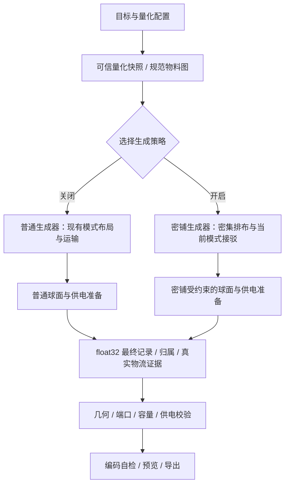

# 超密度建筑排布总体方案

> 2026-11-04 追加目标：超密度追求紧凑矩形内部的实际设备与线路压缩，不采用产线区块独占，不以传送带填空伪造利用率；新增友好的建造区域选择。当前实现见[生成算法源码](../../helper/blueprint/build/algorithm/)，下文早期区块草案不再约束超密度架构。

日期：2026-11-02  
源码重新对齐：2026-11-03，已通过 CodeGraph 核对组合适配器、塔布局契约与公共收尾。  
状态：全场矩形生成器已落地；实际覆盖与限制以当前源码和生成结果为准。游戏实测按用户分工由用户进行。
设计核对基线：`799cafac2d06450073d6e4c8bce07876d7224b15`；当前工作区规则版本为 `dense-v5-global-latitude`。

## 1. 需求与设计结论

**超密度是与生成模式正交的建筑排布选项。用户选择机器直连带、物流配送器、行星内物流塔或星际物流塔后，都可以独立选择是否启用超密度。**

核心目标是让生产机器本身达到参考蓝图所呈现的高密度：缩小可行的机器中心间距、压缩行距、利用朝向与交错关系，同时完成运输、喷涂、供电并能在游戏中落地。仅缩短外围传送带、减小产线块之间的空白，不能作为本功能完成的依据。

产品状态由三个独立维度组成：

| 维度 | 职责 | 示例 |
| --- | --- | --- |
| 生成模式 `mode` | 决定主要运输组织方式 | 直连带、配送器、行星塔、星际塔 |
| 密度设置 `density` | 决定机器及局部接驳的排布策略 | 普通、超密度 |
| 球面设置 `surfaceLayout` | 决定行星网格和可放置纬带 | 自动、旧平面兼容 |

开关不会把物流塔模式改成直连带，也不会自动打开混带、改变配方、升级设备或改变目标产量。不同模式可以具有不同的最终整厂占地，但都应使用同一套可复用的超密度机器排布能力。

不新增第 5、第 6 或第 7 种“超密度生成模式”。内部已有的模式 5/6 也不因本功能而自动对外开放。

内部沿用已建立的 **mode × density 组合适配器**，由字符串 `density`（`standard` / `dense`）选择，继续通过同一个 `Service.Generate` 和 `build.Generate` 入口调用。组合在公共准备前解析；公共准备创建 builder，随后装配几何。dense 已接入参考低层轨道、基础双排和密集单排，塔模式另有两单元优先分组；实际应用范围由最终实体报告。详细定位见[普通与密铺生成器对比及适配器设计](普通与密铺生成器对比及适配器设计.md)。

### 1.1 本方案的完成边界

- 当前四种公开模式均接入超密度开关；切换模式保持开关状态。
- 对已支持的设备、配方端口组合和纬带，实际生成更密集的生产机器阵列。
- 机器数、设备等级、配方和量化物料需求保持可信快照的一致性。
- 每个成功结果具有可追踪的运输连接与明确的校验覆盖，且对应排布规则经过游戏放置验证。
- 第一批优先覆盖参考图中的重组式制造台、量子化工厂、负熵熔炉，再扩大设备覆盖。第一批支持范围不等于最终只支持这些设备。
- 参数化生成必须接受多种机器数量与目标配置，不能把复制整份增产剂蓝图当成完成。

“任意模式可启用”不等于任意设备、任意产量、任意纬度都一定有解。实现过程中必须报告具体能力缺口；发布时应逐项说明支持矩阵，不能把尚未接通的模式长期包装成全模式支持。

## 2. 阅读顺序与依据

1. 本文：产品语义、算法结构、接口与校验原则。
2. [参考蓝图结构分析](参考蓝图结构分析.md)：本轮实际解码所得事实、取样数据和待验证问题。
3. [参考蓝图结构统计](参考蓝图结构统计.json)与[间距和连接数据](参考蓝图间距与连接数据.json)：完整机器行统计及取样建筑记录。
4. [参考数据复核脚本](参考数据复核.py)：重新调用项目编解码器生成两份研究数据。
5. [普通与密铺生成器对比及适配器设计](普通与密铺生成器对比及适配器设计.md)：CodeGraph 源码定位、两种策略的接口边界及后续 agent 的实施指令；进入代码实现前优先阅读。

参考文件：[73125增产剂v1.3（本地版）.txt](73125增产剂v1.3（本地版）.txt)。

用户反馈该参考蓝图可以在游戏中拍下。原研究记录完成了严格解码、重新编码与记录一致性检查；本次文档对齐未重新执行该脚本，未执行游戏放置、生产运行或完整几何规则检查。以下设计明确区分这三种证据。

## 3. 参考图能说明什么

已确认的结构：

- 共 18,069 个建筑记录，其中生产机器 2,113 台。
- 包含 1,430 台重组式制造台、488 台量子化工厂、195 台负熵熔炉。
- 文件具有 4 个 Area 记录，但所有建筑的 `AreaIndex` 均为 0。
- 所有生产机器的首端 XY 坐标都至少有一项偏离整数超过 `1e-4`。
- 机器存在不同朝向；局部坐标中可以找到相当紧密的相邻机器实例。
- 描述声明混带、运输设备不可升降级以及物流塔最后建造；这些是该样例的使用条件。

由此应优先研究“机器原型、朝向、局部相对位置、球面映射和接驳方式”的组合。尚不能得出“任意机器都可重叠”“可以关闭碰撞检查”“小数坐标必然是特殊摆放技巧”或“必须混带才能超密度”的结论。

该样例最重要的用途是建立**建筑密集排布的事实样本和局部规则**。它的物流方式与完整增产剂配方链不应成为跨模式超密度功能的固定前提。

### 3.1 已提取的具体设计数据

下面是原始 Area 局部坐标中的实测数据，不是通用游戏安全间距：

| 原型 / 模型 | 主行横向 ΔX 中位数范围 | 纵向机器行距 | 主阵列朝向 |
| --- | --- | --- | --- |
| 量子化工厂 2317 / 376 | 6.662120～7.144805 | 约 3.897 与 3.498～3.509 交替 | 180°同向 |
| 重组式制造台 2318 / 456 | 3.332884～6.895720 | 双排内约 3.400，双排间约 3.045～3.056 | 180°/0°交替 |
| 负熵熔炉 2319 / 457 | 3.704395～4.019345 | 2.799991、2.316800、2.800000 | 180°/0°交替 |

横向节距随样本的 Y 位置变化，不是全图单一常量；另外存在旋转补位机器。参考分析列出了全部 58 个 Y 分组，可直接用于后续候选复现。

局部运输还呈现两个关键事实：

- 三类机器的代表样本中，输入/输出带的 Y 基本重合，Z 分别约为 **0.125 和 0.500**，高度差约 **0.375**。例如制造台 1198 的输入带 9773 位于 `(6.5844917, 63.288960, 0.12500153)`，输出带 17624 位于 `(10.161760, 63.288956, 0.50000860)`。
- 全图 **2,113 台生产机器均为一条输入臂、一条输出臂**；包括具有两种原料的配方 107/108。超密度跨模式复用必须研究独立多输入端口的变体，不能直接假定原图两臂结构适配所有配方。

因此，第一批实验以“密集机器双排 + 低高度双层带 + 真实分拣器端点”为整体。只把机器行距改成 3.4 或 2.8，而仍使用原有局部接线，不能视为完成适配。

## 4. 当前实现与真正的差距

以下路径均相对应用根目录。除明确写出的公共入口与 placement 外，下表算法文件均位于 `helper/blueprint/build/algorithm/`。

已完成稳定入口转发、Density 请求字段、四模式组合目录和塔布局阶段拆分；仍缺少密集几何、密集装配、只读终检边界、densityReport 以及 UI/工作区闭环。详见[源码对齐表](普通与密铺生成器对比及适配器设计.md)。

| 当前位置 | 已有行为 | 超密度设计需要处理的差距 |
| --- | --- | --- |
| `frontend/src/components/dysonSphere/factory/flow-canvas.vue` | 工具栏提供 4 种模式和带/分拣器等级 | 在现有模式旁增加独立开关 |
| `frontend/src/composables/dysonSphere/useQuantWorkspace.ts` | 生成签名含 mode、布局与球面设置 | 密度设置纳入失效判断、请求与工作区导出 |
| `service/factory/service.go` | 校验 mode 1..4、可信量化快照、串行任务与结果 | 继续拥有公共业务流程，校验密度能力，不新增模式号 |
| `helper/factory/setting.go` | 强制关闭旧 `UseMixed` / `Mix2` | 超密度不复活已移除的混带开关 |
| `helper/blueprint/build/algorithm/line.go`、`geometry.json` | 固定机器类型几何与机器行、带、分拣器装配 | 提供机器原型级的密集阵列与局部接驳候选 |
| `machine_spacing.go` | 基础间距加用户间距，精炼/化工额外加一格 | 将搜索保守余量与真实不可违反的几何规则分开 |
| `mode1.go`、`fly_layout.go`、`station_surround*.go` | 各模式布局、机器行装箱和设施接驳 | 接收共同的密集机器块，保留各自运输语义 |
| `fly_surface_pairs.go` | 已有配送行反向交错候选 | 可借鉴候选隔离与闭合块处理，但仍以完整旧机器行为单位 |
| `transport_router.go` | 已有有界三维 A*、分层占位、端口与路线约束 | 宏观寻路可复用，密集块内部需要更精确的局部拓扑 |
| `surface_encode.go` 与 `surface_*.go` | 球面锚点、跨带映射、完整块重排 | 密集块的相对关系不能被后续自动装箱或坐标重写破坏 |
| `rule_audit.go`、`placement/` | 最终 float32 记录、真实数值建造盒和连接规则 | 用参考图校准规则；不能用超密度布尔值直接跳过终检 |
| `helper/blueprint/codec.go`、`encode.go` | 无损记录、严格解析与编码自检 | 直接复用，不重新发明游戏格式 |

当前算法并非只能做二维整数寻路：主运输路径已经有三维搜索，底层也能保存浮点坐标。问题主要在于**候选生成的粒度和约束表达**：先固定规则机器行及其带路，再装箱，通常无法发现需要同时改变机器位置、行间关系和局部接线的高密度方案。

因此，重点不是单纯增加 A* 预算，也不是统一修改 `geometry.json` 中的间距常量，而是新增一套机器与局部运输共同设计的排布候选。

## 5. 总体结构：模式组织运输，密度策略组织机器



图中的环节是职责边界，不要求把现有所有模式一次性重写成统一框架。按模式接入时复用已有稳定能力，逐步抽出真正需要共享的数据契约。

当前 `finish` 会进行球面重排、补电和电杆裁剪，不能直接当成只读编码器。普通/密铺各自完成可修改布局的准备阶段，再提交最终记录与运输证据给共同终检。候选循环中每个参与排名的结果都必须经过终检，最终预览仅发布被选中的成功结果。

超密度内部允许“排布候选 → 局部接驳 → 模式外围连接 → 终检 → 拒绝或接受”的有界回溯。机器阵列不是完全不考虑运输的独立装箱结果。

### 5.1 超密度块包含什么

一个密集块由以下内容组成：

- 生产机器的原型、模型、数量、配方与最终姿态。
- 保持密度所需的分拣器、局部带、喷涂通道，以及必要的局部供电设施。
- 按物品区分的外部输入、输出和供剂端口。
- 允许外围模式使用的接驳空间、高度、方向与容量约束。
- 不能随意穿越的真实占位、保留通道和原子组合关系。
- 球面适用条件、局部排布规则版本及验证证据。

**几何规则库按机器原型组织，局部接驳规则按物料端口签名组织，模式适配器按运输方式组织。** 三者组合，避免为每个具体成品复制一套生成器。

## 6. 建筑密度的实现方法

### 6.1 先提取机器邻接关系，后归纳可参数化规则

从参考图按 `ItemID + ModelIndex` 提取机器，保留原始 float32 和记录顺序：

1. 复原 Area、候选放置锚点及其球面世界坐标；确认该样例所有建筑引用 Area 0 的真实语义。
2. 按球面距离寻找邻居，提取相对位移、朝向、相邻行相位及高度关系。
3. 将近邻对、交错双排、连续机器阵列聚类；分别记录内部、边界、转折和特殊尾段。
4. 追踪这些机器的真实分拣器、局部带与喷涂连接，形成最小功能块。
5. 用多个位置和多种数量验证周期性；若布局随纬度改变，应表达为纬带相关规则。

不能只按画面裁矩形来切模板，也不能只凭坐标看起来重复就判定可以平移复制。截取样本时保留所有外连引用，并将真实边界显式转成端口。

### 6.2 候选族

首批需要验证的候选族如下，表中不是已证实的游戏规律。

| 候选族 | 要解决的问题 | 允许参数化的前提 |
| --- | --- | --- |
| 同向紧密单排 | 机器中心横向间距过大 | 实测建造盒、槽位与局部带均可行 |
| 反向交错双排 | 两排机器之间保留过宽通道 | 朝向改变后的槽位映射、分拣器和带可完整接通 |
| 纬带适配阵列 | 同一局部格距在不同纬带产生不同真实间距 | 已验证的锚点范围和球面坐标变换 |
| 端部补齐块 | 机器数不是周期单元整数倍 | 独立验证首端、尾端、余数单元的运输与供电 |
| 分层局部接驳 | 地面空间不足，机器间仍需运输 | 真实高度、连接距离、端口及动态占位通过 |

首批以参考图的 2318、2317、2319 原型建立规则。不同等级即使属于同一机器类型，也必须分别校验模型与端口；不能把量子化工厂规则无条件用于所有化工设备。

### 6.3 不使用通用“缩放系数”

超密度参数由受约束的候选构成，而非 `spacing *= 0.5`：

- 建筑模型大小不变。
- 不通过负附加间距绕过现有校验。
- 中心间距、朝向与错位由具体原型的规则决定。
- 机器、分拣器两端、带连接、供剂和电网必须一起验证。
- 不把负的微小高度一律归零，不把小数坐标统一吸附到整数。
- 任意镜像、旋转、跨纬带移动都属于需要验证的新变换；特别是镜像不能只改 X 符号。

普通模式继续使用原有间距策略。某项硬规则如果经复核发现确有模型错误，应修正为版本化的正确规则，并回归全部模式；不是仅在超密度下将错误静默忽略。

### 6.4 保持量化机器数与目标不变

以量化快照要求的每条产线机器数为输入，由周期单元与余数单元组成实际阵列。缺少余数单元时尝试另一种密集候选；仍无解则明确失败。

本方案不以自动增减机器、改变配方或提高设备等级来凑整模板。若未来引入“整模块扩容”，应单独设计用户可见的容量决策与重新量化流程，不混入当前开关。

## 7. 与现有寻路的分工

### 7.1 块内采用已验证的接驳结构

高密度机器块内部的运输空间应由排布规则共同确定：

- 按端口签名选择局部带和分拣器布局。
- 优先复用经验证的坐标与连接关系；根据重复次数安全重建索引。
- 对小范围缺口可以做有界局部搜索，但不得为了找到路随意拉开机器阵列。
- 相同净物料边可以映射到多条真实运输段，必须给出完整映射，不能仅记录装饰性端口。

局部结构不要求所有配方都使用混带。当前混带能力没有完整验证，不能借超密度开关整体恢复它。若参考图某个最密集单元确实依赖混带，应标为专门能力；先寻找独立物料带可行的密集变体，再单独安排混带研究。

### 7.2 块外保留模式语义与有界寻路

普通 A* 可继续用于块外连接；它接收的是密集块已经暴露的真实端点及可用通道。

当前主寻路器使用各轴单位步长和精确终点匹配，`beltCell` 对三轴取整。密铺小数端口必须经过验证的局部过渡连接到满足搜索条件的外围端口，不能直接交给旧 A*，也不能先把端点四舍五入再声称连接完成。

| 模式 | 超密度共同部分 | 模式专属部分 |
| --- | --- | --- |
| 机器直连带 | 密集机器阵列、局部端口和喷涂 | 按规范物料边连接不同生产块，处理分流、回流与外部边界 |
| 物流配送器 | 同一套机器排布候选 | 配送箱、配送器、地面取放路径与配送能力约束 |
| 行星内物流塔 | 同一套机器排布候选 | 行星塔位置、真实塔间距、物品槽、出入口和本地接驳 |
| 星际物流塔 | 同一套机器排布候选 | 星际塔的原型、槽位、运输设置和外围接驳 |

不同模式可以选择不同的局部端口变体，而不改变密度功能的统一入口。塔和配送设施的合法占地不必与参考图完全一致；需要比较的是相同条件下的机器密度和整厂效果。

### 7.3 占位模型分层

至少区分：

1. **真实禁止占位**：建筑建造盒、合法连接以外的冲突、独占端口。
2. **局部预留资源**：已经验证的分拣器走廊、带通道、供剂和块外接驳窗口。
3. **搜索保守余量**：为了普通排布和搜索效率设置的扩大轮廓、整格缓冲。

超密度可使用更精细的候选与占位表示代替第 3 类，不能任意取消第 1 类。已有空间索引与 OBB 窄相位能力应尽量复用。必要时使用局部连续姿态候选，避免全图加密栅格带来的状态爆炸。

## 8. 球面与校验策略

### 8.1 球面规则属于密度可行性

机器在一个纬带能拍下，不代表相同局部坐标可以在另一纬带直接复制。密集块须携带：

- 网格/行星适用条件与可用锚点范围。
- 允许的整体平移、旋转和跨带变换。
- 必须保持的机器相对姿态与局部连接。
- 是否允许跨 Area，跨界时的双端坐标转换规则。

首次验证先保留参考图的完整 Area 与坐标关系。生成新方案则由已校准的映射生成合法区域，不能把“全部引用 Area 0”推广成全部新蓝图都应遵循的格式规则。

超密度块在后续装箱中作为有约束的整体处理。若现有 `surface_*` 过程会改变密集关系，就添加适配入口或重做该候选，不直接把既有 finish 流程视为无副作用。

### 8.2 参考图与现有校验不一致时的处理

已复现参考图被旧传送带整段规则误拒绝，并核对原版单次蓝图粘贴的带预览与节点合并规则；详见[密铺仙术机制核对](密铺仙术机制核对.md)。这项检查通过不代表原图全部几何规则或游戏运行已通过。

后续应首先输出完整的冲突诊断：建筑编号、原型、规则、Area、最终坐标、放置锚点。逐项判断：

| 差异来源 | 处理方式 |
| --- | --- |
| 仅被候选阶段的保守间距拒绝 | 调整超密度候选生成，不放宽真实终检 |
| Area 或球面变换解释错误 | 修正坐标解释并回归原有模式 |
| 建造盒、槽位或规则适用范围不准确 | 校准规则及版本，记录最小复现 |
| 依赖特定建造阶段或游戏机制 | 建立明确的条件规则和构建顺序；验证后才扩大适用范围 |
| 依赖未知环境、Mod 或未确认条件 | 将能力保持为未验证，不能宣称通用原版支持 |

不能通过缩小全局建造盒、跳过所有碰撞、忽略全部小数坐标错误或白名单整个文件来实现生成。精确原图的实测证据也只覆盖对应文件与环境，不能自动覆盖被裁剪、移动或改配方后的产物。

### 8.3 证据分层

- `formatVerified`：严格解码、索引和重新编码通过。
- `numericVerified`：本次最终 float32 记录通过明确列出的几何、端口与容量规则。
- `patternPlacementVerified`：排布规则在声明的游戏环境、数量和纬带范围有放置证据。
- `artifactRuntimeVerified`：特定输出蓝图完成实际建造与运行验证。

前两项可以在每次生成时计算；后两项来自有环境与文件指纹的验收记录。界面不能把“规则已实测”写成“这次输出已实测”，也不能把现有 `EncodeResult.Verified` 解释为可放置。

若样例要求物流塔最后建造，需验证排序是否真正影响游戏建造；单纯修改 `Building.Index` 或数组顺序不能代替验证。只有确实需要分阶段建造的排布，才提供对应说明或阶段产物，并将其标为有条件能力。

## 9. 请求、结果与模块边界

以下区分当前请求契约与待新增能力；结果报告和密集块类型仍是设计提案。

### 9.1 请求

`build.Request`（别名指向 `algorithm.Request`）已有独立的 density 字符串；生成绑定也已包含该字段。工作区请求尚需补齐同一字段：

```json
{
  "mode": 3,
  "density": "dense"
}
```

缺省或 `standard` 使用普通路径，`dense` 选择密集组合，未知值返回现有 `GEN_E_DENSITY`。不新增旧草案的 `density.enabled` 对象。界面提供“超密度 · 试验”开关，不提供忽略碰撞或压缩比例；成功结果包含实际覆盖和规则版本，无法满足端口、容量或几何约束时明确拒绝。

客户端不决定规则版本与支持范围；后端按当前数据集、原型、端口需求、模式、科技配置和纬带选择规则，并返回所用版本。工作区导出保存用户开关和生成时的规则版本提示，重开或重算时重新校验，不信任旧文件携带的“已验证”标记。

当前 `MarshalWorkspace` 输出 `formatVersion: 1`。建议新增字段时输出版本 2；未来的读取逻辑须明确支持 v1 缺省关闭、v2 读取开关及未知版本拒绝，不假设当前已经有完整方案 JSON 导入功能。

### 9.2 内部契约

建议在 `helper/blueprint/density/` 放置不依赖 Wails 的排布与规则实现：

| 契约 | 主要内容 |
| --- | --- |
| 密度键 | 复用已有 Density 字符串，缺省 standard；不重复定义布尔请求对象 |
| `PatternProfile` | 机器/模型、候选族、局部变换、纬带范围、规则版本、证据范围 |
| `PortDemand` | 物品、方向、净流/机器毛流、供剂、端口数量与能力要求 |
| `BlockCandidate` | 机器与局部设施记录、端口、占位、原子关系、产线归属 |
| `ModeConstraints` | 塔/配送/直连的外围接驳要求及可用空间 |
| `Report` | 实际应用范围、密度指标、失败原因与验证覆盖 |

`algorithm` 或具体组合调用拟新增的 `density` 包，后者使用独立类型和 `blueprint` 基础记录，不反向导入 build/algorithm。跨阶段数据放在现有 `build/contract`，私有实体转换暂留 algorithm，避免包循环。

生成层沿用 `algorithm/mode_adapters.go` 与 `adapters/mode{1,2,3,4}/{standard,dense,common}`，不另建 generationStrategy 注册系统。塔模式已有 StationAdapter，但其计划目前只表达分区、行数与分组；需扩展密集块数据及实体装配。共享终检仍需隔离布局副作用并接收真实运输证据。

服务层继续负责可信方案复核、输入校验、取消与替代、操作日志、分片结果和导出。规则库只保存数据及算法证据，不承担完整服务工作流，也不新增数据库模型保存可由源码规则推导的内容。

### 9.3 结果

在 `algorithm.Result` 上增加（通过 `build.Result` 别名公开） `densityReport`，保留既有 Blueprint、Bindings、Zones、LogisticsSummary、RuleAudit 与性能数据。

建议报告包含：

- `requested`、`applied`、规则集版本及最终生成指纹。
- 按产线/原型记录已应用的候选、机器数和能力状态。
- 机器阵列面积、局部功能块面积、整厂面积及各自单位/坐标口径。
- 同条件普通方案对照的来源；没有实际对照就不显示节省百分比。
- 已执行的校验、排布规则实测范围及当前输出未实测项。

密度请求加入生成签名、缓存键、进度关联和结果来源记录。生成指纹至少包含可信 plan、mode、density、布局、球面设置及规则版本；不能只按 `PlanID` 复用几何结果。

## 10. 界面行为

在 `flow-canvas.vue` 现有生成模式选择器旁增加一个“超密度”开关，四种模式均显示。说明文案建议：

> 按设备与纬带使用更紧密的机器排布，保持当前运输模式。

右侧布局参数区显示所需设备/科技、应用范围与失败原因，复用现有平铺参数区与 Naive UI 控件，不新增大面积独立卡片。

具体行为：

1. 默认关闭；切换运输模式保留开关。
2. 切换开关使蓝图结果失效，实时模式重新生成；仅修改密度无需改变量化输入。
3. 生成期间沿用现有取消、替代及最新请求规则，防止普通结果覆盖新的超密度结果。
4. 明确保持用户选定的设备与运输等级；某候选不兼容时给出原因，不静默升级。
5. 无解或规则未覆盖时返回具体失败，不静默回退为普通结果并仍显示“已超密度”。
6. 对多产线方案，首版默认要求所有请求范围内生产块获得可支持的密集排布；未来若允许部分应用，应明确显示逐产线覆盖，并作为单独的产品决策。
7. 大图预览仍遵循现有规模保护；整图导出不受隐藏线路、只看机器等展示操作影响。预览优化不是超密度能力的验收替代。

“可以在任意模式勾选”与“该请求能否找到完整可用方案”由不同信息表达。研发期间未覆盖组合可以明确失败；全模式交付不能只完成控件而留下某模式永久失败。

## 11. 如何证明建筑密度提高

应同时给出三个口径，不能只用总建筑数除以整厂矩形面积：

| 指标 | 定义与用途 |
| --- | --- |
| 机器阵列密度 `D_machine` | 相同生产机器集合的数量 / 机器阵列外包区域面积；体现机器本身排布 |
| 局部功能密度 `D_block` | 同一集合的机器数量 / 含必要局部运输、喷涂与供电的块面积；防止仅机器靠拢而功能无解 |
| 整厂占地 `A_factory` | 含外围物流设施、通道和电网的整体面积；体现实际使用成本 |

补充机器近邻距离分布、行距/相位、模式、原型构成、纬带、产能需求与运输约束。多原型混合比较须同时给出分原型指标。

面积测量采用统一、版本化口径：在同一锚点和球面映射下使用相同的测地/局部投影方法，包含机器外形；跨带分区必须按定义避免重计或漏计。原始 Area 宽高和局部 XY 包围盒仅作结构统计，不直接当成物理面积。

对照必须固定配方、机器类型与数量、等级、喷涂、科技、模式、放置条件和外部边界。普通生成失败时显示“无可比基线”，不能宣称节省比例。

建议在基线阶段冻结两类门槛：

- 普通对照门槛：三类首批设备的代表性中大型阵列，机器阵列面积至少减少 20%（建议工程目标，尚未测得），同时局部功能密度改善、整厂占地不恶化。
- 参考形态门槛：对已确认的参考局部单元，在同条件和同规模下，生成器的机器密度达到该单元实测密度的 95% 以上（建议目标）。用它避免把“略微紧凑”当成参考级超密度。

门槛必须在实际测量后固定为可复验数字。若无法达到，应报告具体限制并继续优化，不能通过缩小统计边界或更换对照条件使其通过。小机器数另设可行性用例，不强制套用中大型阵列的面积比例。

## 12. 实施优先级

优先验证建筑密度的来源，再扩大模式覆盖：

1. 建立参考图解码基线、球面解释和最小机器密集单元。
2. 固定当前组合适配器的普通路径基线，继续拆分收尾副作用；入口与组合目录已建立，不重复包装。与密集单元研究并行。
3. 校准几何与游戏放置规则，确认能保留的机器相对位置。
4. 在密铺生成器内实现机器数量可变、余数可补齐的密集块及局部运输。
5. 逐个接入四种模式，完成同条件开关前后对照。
6. 扩大设备/配方覆盖并完善性能、预览和回归。

具体依赖与任务接入点应结合当前生成算法源码核对。复制原图、降低碰撞阈值、只增加开关或只缩短外围带路，都不能单独结项。
